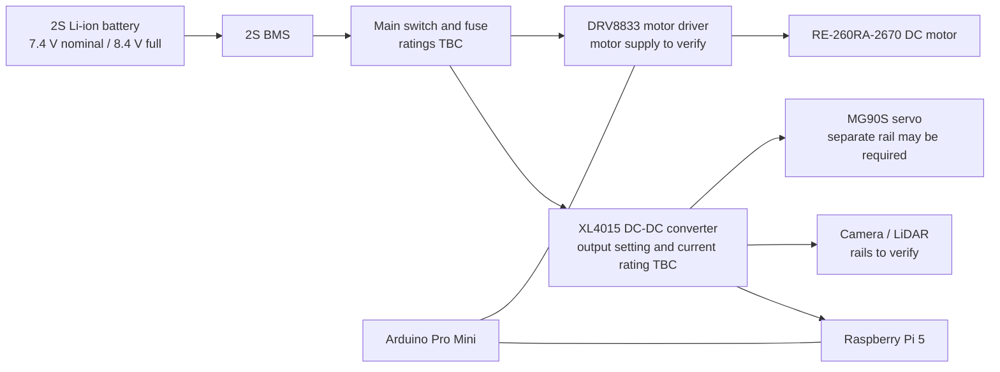

# Power Management

This document describes the current power-system concept for the InnoBots robot. It is a **design draft**, not a verified wiring or safety document. Values that have not yet been confirmed from the actual components or measurements are labelled accordingly.

## 1. Battery and protection

| Parameter | Current project information |
|---|---|
| Battery chemistry | 2S Li-ion (reported by the team; confirm the actual pack label) |
| Nominal voltage | 7.4 V (2 cells in series) |
| Fully charged voltage | 8.4 V (4.2 V per cell) |
| Capacity | 3000 mAh (reported; verify on the actual pack) |
| Maximum continuous discharge | 20 A (reported; verify on the actual pack label or datasheet) |
| Battery management system | 2S BMS (confirm its current rating and protection functions) |
| Low-voltage cutoff | 5 V was listed in the previous draft; confirm the correct cutoff from the battery and BMS specifications |

The 3000 mAh capacity and 20 A discharge rating are **reported values, not yet verified against the actual battery**. Do not use them for a final runtime or safety claim until they have been checked.
## 2. Power architecture

The intended system-level arrangement is:

This block diagram shows the intended functional groups only. It is **not a pin-to-pin wiring schematic**. The actual regulator outputs, grounds, fuses, connectors, and signal-level interfaces still need to be documented.

## 3. Loads and power budget

A reliable power budget needs the actual supply voltage and current for every device. The table below lists the planned loads and the information needed to complete the calculations.

| Load | Intended supply | Current / power information |
|---|---|---|
| Raspberry Pi 5 | Regulated 5 V rail | Measure under the robot's real workload; verify regulator capacity |
| Camera Module 3 | Raspberry Pi camera interface | Include its consumption in the total Pi-system load |
| D500 LiDAR | Supply specified by its exact datasheet | Exact model, voltage and current still need confirmation |
| MG90S servo | Regulated servo rail | Confirm supply voltage and peak/stall current |
| Arduino Pro Mini | Regulated logic rail | Confirm whether the board is the 3.3 V or 5 V variant |
| RE-260RA-2670 motor | Motor rail to be verified | Selected motor reference is 3.0 V; datasheet lists 0.97 A at maximum efficiency and 4.73 A stall current |
### Critical motor-supply mismatch

The motor-selection reference supplied by the team identifies the **RE-260RA-2670 at DC 3.0 V**. The battery is a 2S Li-ion pack with a nominal voltage of 7.4 V and a fully charged voltage of 8.4 V. The motor must **not** be connected directly to the 2S battery unless the exact motor datasheet and final design explicitly permit that voltage. The motor-side voltage regulation or other approved supply arrangement must be confirmed and shown in the wiring diagram.

The motor reference lists a 4.73 A stall current at 3.0 V. This is not the normal running current, but it is important when checking the DRV8833 board, wiring, supply and protection. Confirm the exact driver module's current and thermal limits before operation.

### Why a final total and runtime are not shown yet

The earlier draft estimated a 29.9 W peak load and calculated runtime from an assumed 3000 mAh battery. Those figures depend on unverified battery and load assumptions, and the earlier motor supply entry did not match the selected 3.0 V motor reference. We are therefore withholding a final total current, power margin and runtime until the component ratings and measurements are confirmed.

## 4. Verification checklist

- [ ] Photograph/read the battery label: chemistry, capacity, voltage and discharge rating.
- [ ] Record the 2S BMS model and continuous/peak current ratings.
- [ ] Record the XL4015 module's actual configured output voltage and verify its continuous-current and thermal capability.
- [ ] Confirm the motor supply arrangement for the 3.0 V RE-260RA-2670.
- [ ] Confirm the exact DRV8833 module and compare its limits with the motor's current requirements.
- [ ] Confirm the MG90S servo's required voltage and peak current; do not power it from a microcontroller GPIO pin.
- [ ] Confirm the exact D500 LiDAR model and its voltage/current/interface requirements.
- [ ] Confirm the Arduino Pro Mini variant (3.3 V or 5 V).
- [ ] Draw the final wiring schematic, including grounds, connectors, fuse, switch and regulator outputs.
- [ ] Measure the 5 V rail under Pi and sensor load.
- [ ] Measure motor current during startup, normal driving and controlled load tests.
- [ ] Verify regulator temperature and voltage stability during a full test run.
- [ ] Determine low-voltage cutoff from the actual battery and BMS specifications.
- [ ] Calculate runtime only after recording measured average battery current.

## 5. Evidence to add

To make this section reproducible and suitable for judging, add:

1. A clear photo of the battery label and BMS board.
2. A photo of the XL4015 module showing its markings and adjustment setting.
3. A wiring diagram showing the actual connection from battery to BMS, switch/fuse, regulators, motor driver and loads.
4. A measured current table for idle, computing/sensor load, motor running and steering movement.
5. A short test record showing voltage before and after a representative run.

---

*InnoBots · WRO Future Engineers 2026 · Power architecture status: design draft awaiting hardware verification.*
