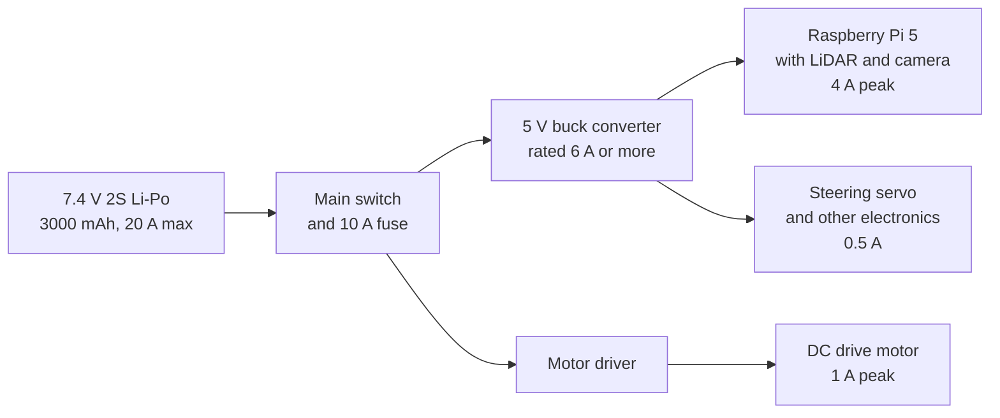

# Power Management

This document describes the power system for the robot: the battery, the load budget, power distribution, expected runtime, and protection. All figures are design estimates based on the peak current values listed below. Verify them with measurements before relying on them.

## Battery

| Parameter | Value |
|---|---|
| Chemistry | 2S Li-Po (assumed from the 7.4 V nominal voltage) |
| Nominal voltage | 7.4 V |
| Full charge voltage | 8.4 V (4.2 V per cell) |
| Low-voltage cutoff | 6.4 V (3.2 V per cell), recommended |
| Capacity | 3000 mAh (22.2 Wh) |
| Max continuous discharge | 20 A (about 6.7C) |

Confirm the chemistry and cell count against the pack label.

## System Loads

| Load | Supply rail | Peak current | Peak power | Battery-side current |
|---|---|---|---|---|
| Raspberry Pi 5, LiDAR, and camera | 5 V | 4.0 A | 20.0 W | 3.0 A |
| Steering servo and other electronics | 5 V | 0.5 A | 2.5 W | 0.38 A |
| DC drive motor | 7.4 V (battery) | 1.0 A | 7.4 W | 1.0 A |
| **Total** | | | **29.9 W** | **4.4 A** |

Assumptions used in these numbers:

- The 5 V buck converter is 90% efficient. At 85% efficiency, the battery-side peak rises to about 4.6 A.
- All peaks occur at the same time. This is a worst-case budget.
- The steering servo and other electronics draw from the 5 V rail. If the servo requires 6 V, power it from a separate regulator and recalculate.
- The motor draws its current directly from the 7.4 V battery. Motor driver losses are not included.

## Power Architecture

## Power Budget and Runtime

At the worst-case battery-side peak of 4.4 A, the pack delivers about 32.4 W.

- **Discharge margin:** 4.4 A is 22% of the 20 A rating, a margin of about 4.5x.
- **C-rate at peak:** about 1.5C, which is within the pack’s capability.

Runtime is calculated as capacity divided by average battery current:

| Average battery current | Estimated runtime |
|---|---|
| 4.4 A (sustained worst-case peak) | about 41 min |
| 2.2 A (50% average duty) | about 82 min |
| 1.1 A (25% average duty) | about 164 min |

The duty-cycle rows are illustrative. Replace them with measured averages. Actual runtime will be shorter because of the low-voltage cutoff and internal resistance under peak load.

## Hardware Requirements

- **5 V buck converter:** rated at least 6 A continuous. The Raspberry Pi 5 official supply is 5 V and 5 A, and the peak budget here is 4.5 A on the 5 V rail.
- **Main fuse:** 10 A on the battery positive line, mounted close to the pack. This is above the 4.4 A peak and below the pack’s 20 A rating.
- **Wiring:** at least 18 AWG for the main battery path.
- **Charger:** a balance charger rated for 2S Li-Po.
- **Optional monitoring:** a current and voltage sensor such as the INA219 on the battery line, for logging real draw.

## Protection

- Set the low-voltage cutoff at 6.4 V (3.2 V per cell). Do not discharge below 6.0 V (3.0 V per cell).
- Never exceed the 20 A continuous discharge rating. Stall current from the motor must stay within the driver limit.
- Charge at 1C (3 A) or lower unless the pack datasheet allows more.
- Charge only with a balance charger, supervised, on a fire-resistant surface.
- If the pack will be stored for a long time, bring it to about 3.8 V per cell (7.6 V pack).

## Verification Checklist

- [ ] Measure real current draw on the 5 V rail under full load
- [ ] Measure real current draw on the motor circuit under full load
- [ ] Confirm the steering servo’s operating voltage
- [ ] Confirm the buck converter holds 5 V at 4.5 A
- [ ] Confirm the low-voltage cutoff triggers at 6.4 V
- [ ] Confirm the main fuse does not open during motor startup
