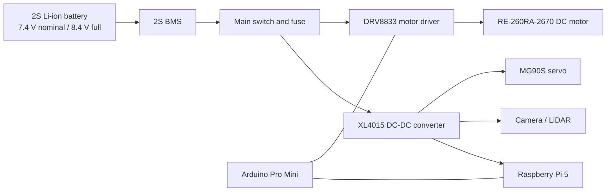

# Power Management

This document describes the power-system architecture and the electrical load estimate for the InnoBots robot.

## 1. Battery and protection

| Parameter | Project design value |
|---|---|
| Battery chemistry | 2S Li-ion |
| Nominal voltage | 7.4 V |
| Fully charged voltage | 8.4 V (4.2 V per cell) |
| Capacity used in the estimate | 3000 mAh |
| Maximum continuous discharge value used in the design notes | 20 A |
| Battery management system | 2S BMS |
| Low-voltage cutoff noted in the design | 5 V |

The capacity and discharge figures are the values recorded in the project design notes. Actual battery and BMS ratings depend on the installed pack and its manufacturer specifications.

## 2. Power architecture

The system-level arrangement is:



The diagram presents the functional power groups: the battery and BMS feed the protected distribution point; the regulated branch supplies low-voltage electronics; and the motor-driver branch supplies the drive motor.

## 3. Loads and power budget

The table groups the peripherals with their associated controller or subsystem.

| Component / group | Current consumption (peak estimate) |
|---|---:|
| Raspberry Pi 5, Camera Module 3 and D500 LiDAR | 4 A |
| Arduino Pro Mini and MG90S servo | 200 mA |
| RE-260RA-2670 DC motor | 1 A |

The estimated maximum current consumption of the complete system is approximately **5.2 A**. This is a peak-load estimate; normal operating current varies with processor workload, sensor activity, steering movement, and motor load.

With the **3000 mAh** capacity value used in the design notes, the theoretical autonomy at a constant 5.2 A is approximately **35 minutes**:

```
Runtime = Battery capacity / Load current
        = 3.0 Ah / 5.2 A
        ≈ 0.577 h
        ≈ 35 minutes
```

Actual runtime depends on battery condition, load profile, conversion efficiency, and the battery's usable capacity.

## 4. Electrical design considerations

- The Raspberry Pi 5 requires a stable regulated supply capable of supporting its load.
- The camera and LiDAR supply rails must match their respective operating-voltage requirements.
- The MG90S servo draws current from its supply during movement and under mechanical load.
- The DRV8833 motor-driver supply and thermal behavior depend on motor load and driver-board implementation.
- The motor reference data lists a 3.0 V nominal operating point. The motor supply arrangement should therefore be interpreted separately from the 2S battery's 7.4 V nominal voltage.
- Raspberry Pi GPIO uses 3.3 V logic and is not 5 V tolerant. Signal interfaces must respect the voltage limits of each connected device.
- Battery protection, fuse selection, wire sizing, connector ratings, and grounding are part of the overall power-system design.

---

*INNOBOTS · Ibn Mandour High School · Morocco · WRO Future Engineers 2026*
