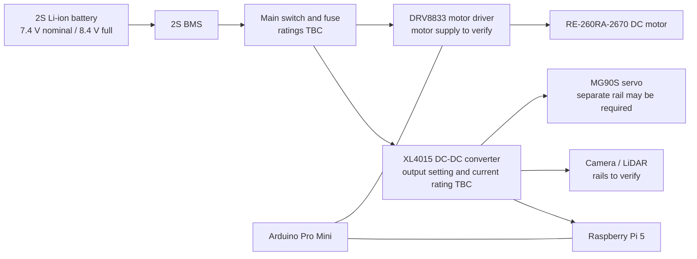

# Power Management

This document describes the current power-system concept for the InnoBots robot. It is a **design draft**, not a verified wiring or safety document. Values that have not yet been confirmed from the actual components or measurements are labelled accordingly.

## 1. Battery and protection

| Parameter | Current project information |
|---|---|
| Battery chemistry | 2S Li-ion (reported by the team; confirm the actual pack label) |
| Nominal voltage | 7.4 V (2 cells in series) |
| Fully charged voltage | 8.4 V (4.2 V per cell) |
| Capacity | 3000 mAh (reported; verify on the actual pack) |
| Maximum continuous discharge | 20 A (reported; verify on the actual pack label or datasheet) |
| Battery management system | 2S BMS (confirm its current rating and protection functions) |
| Low-voltage cutoff | 5 V was listed in the previous draft; confirm the correct cutoff from the battery and BMS specifications |

The 3000 mAh capacity and 20 A discharge rating are **reported values, not yet verified against the actual battery**. Do not use them for a final runtime or safety claim until they have been checked.
## 2. Power architecture

The intended system-level arrangement is:

This block diagram shows the intended functional groups only. It is **not a pin-to-pin wiring schematic**. The actual regulator outputs, grounds, fuses, connectors, and signal-level interfaces still need to be documented.

## 3. Loads and power budget

The table groups the peripherals with the controller they connect to. The power-consumption values are listed where known; values that still need datasheets or measurements are marked **TBC**.

| Component / group | Current Consumption(Peak Current) |
|---|---|
| Raspberry Pi 5, Camera Module 3 and D500 LiDAR |4 A |
| Arduino Pro Mini and MG90S servo | 200 mA  |
| RE-260RA-2670 DC motor |1 A |

Total current consumption and estimated autonomy: The estimated maximum current consumption of the complete system is approximately 5.2 A. This represents a peak-load estimate; actual current consumption during normal operation is expected to be lower. With the reported 3000 mAh battery capacity, the theoretical autonomy at a constant 5.2 A would be approximately 35 minutes. In practice, autonomy will depend on the robot's workload, battery condition and voltage-conversion efficiency. These values are estimates and should be verified through real measurements.
