# Mechanical Design

This folder contains the SolidWorks parts and the pictures of the finished robot. We have put the CAD views next to photographs of the real car because it is easier to understand the design when you can see the model and the assembled vehicle together.

The goal was to build a compact car that could carry its electronics and sensors without making the chassis unnecessarily complicated. The plates and brackets give us places to mount the hardware, while keeping the wheels, steering and drive system accessible.

## The chassis

The main chassis is the base that holds the robot together. In the SolidWorks model, you can see the overall outline and the mounting holes. Those holes give us points to fasten the other parts and arrange the components on the car.

  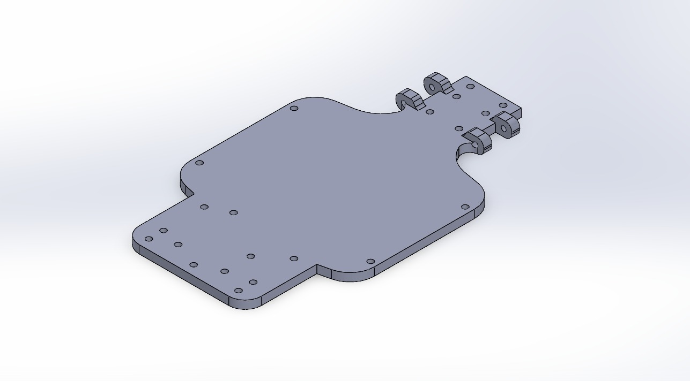
   <em>Main chassis — SolidWorks model.</em>

Here is the assembled robot from the front and the rear. The real photographs show how the chassis supports the electronics and the mechanical parts once everything is installed.

<table>
  <tr>
    <td align="center">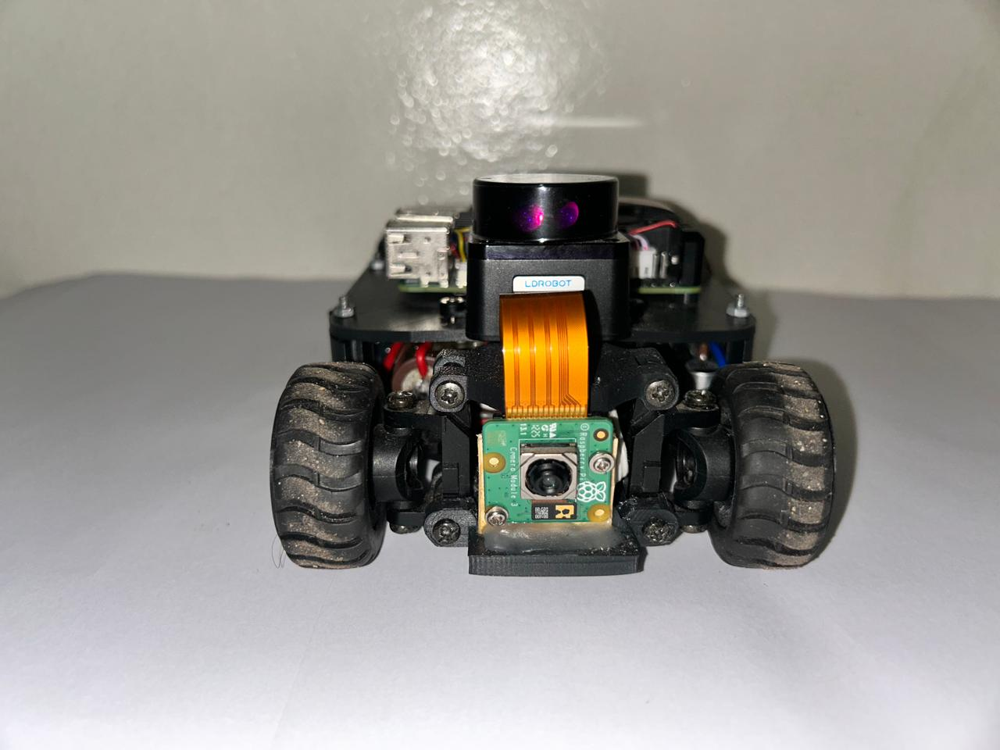 <em>Assembled robot — front.</em></td>
    <td align="center">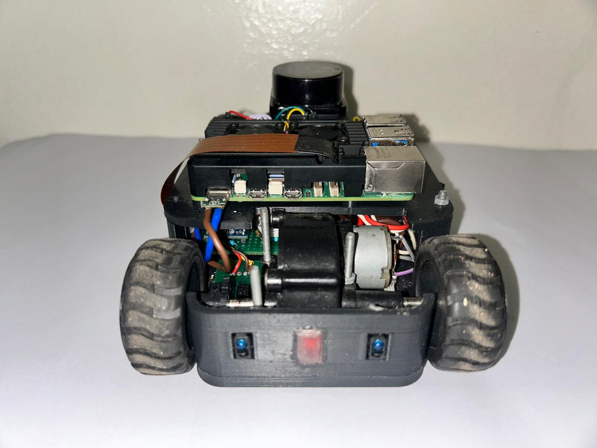 <em>Assembled robot — rear.</em></td>
  </tr>
</table>

## Upper plate and component mounting

The upper chassis plate gives us another level for mounting the electronics. The raised circular supports and the slots are visible in the CAD model. They provide mounting positions and openings within the plate layout.

  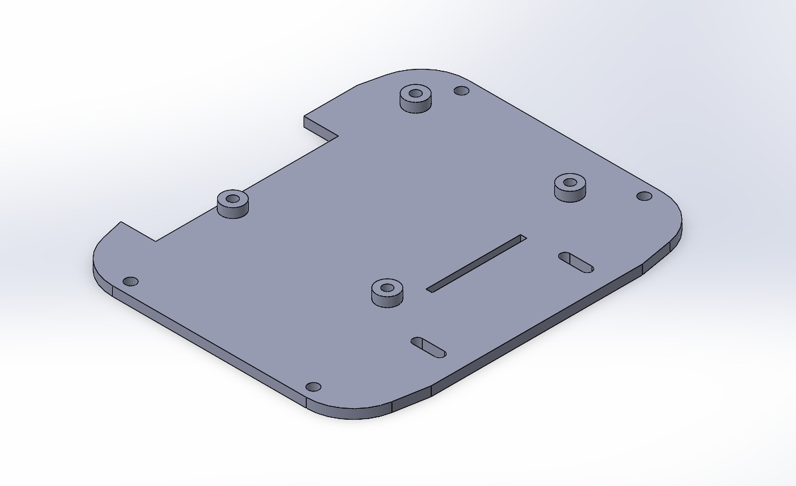
   <em>Upper chassis plate — SolidWorks model.</em>

The top photograph shows how the real vehicle is arranged: the computing board and its cooling assembly sit on the upper level, with the sensor hardware and wiring arranged around them. The model and photograph show the design and the finished arrangement respectively; they are not intended as a dimensioned drawing.

  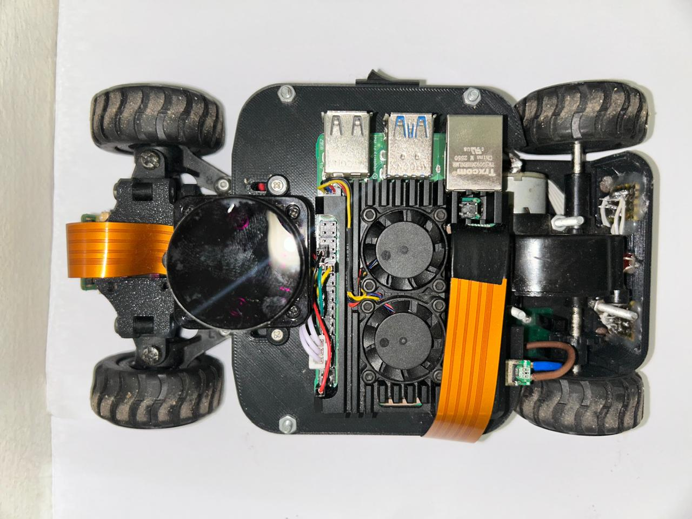
   <em>Assembled robot — top view.</em>

## Side and rear structural pieces

The folder also contains two smaller structural parts. The side-mount model is a narrow piece with fixing holes and rectangular openings. The curved cover has several rectangular openings along its face. These shapes provide mounting or access openings where needed.

<table>
  <tr>
    <td align="center">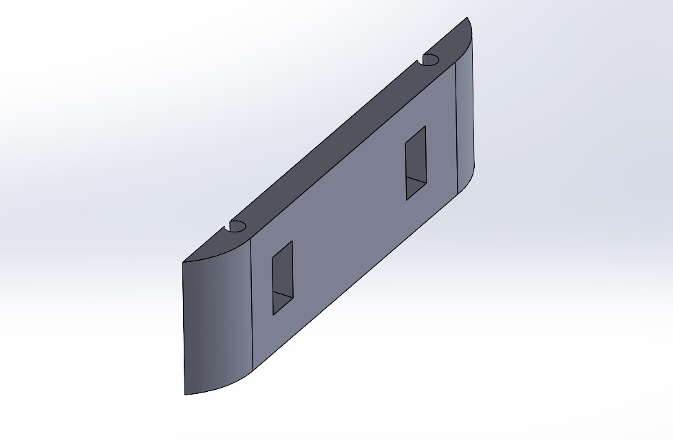 <em>Side mounting piece.</em></td>
    <td align="center">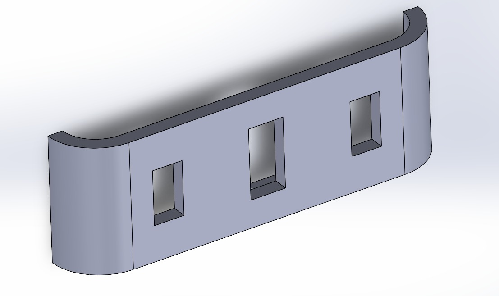 <em>Curved side cover.</em></td>
  </tr>
</table>

The left and right photographs show the side profile of the assembled car. They help show how the body panels sit around the wheels and the internal components.

<table>
  <tr>
    <td align="center">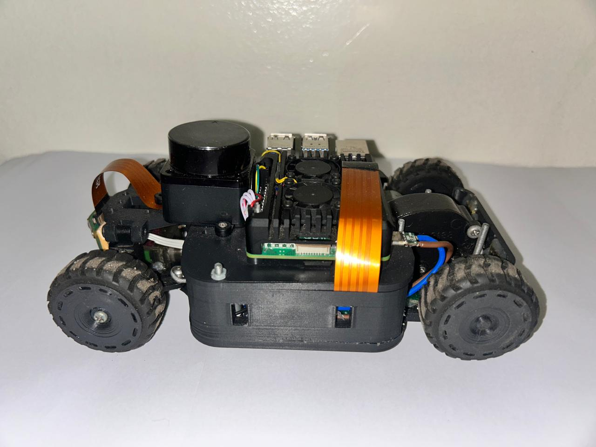 <em>Assembled robot — left side.</em></td>
    <td align="center">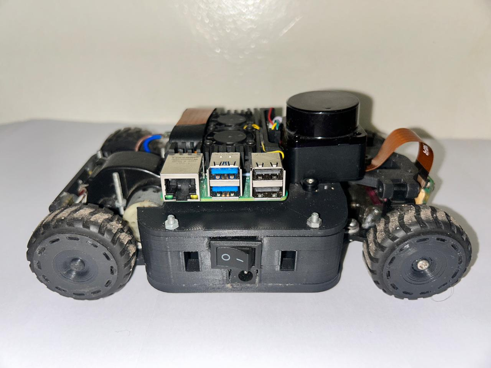 <em>Assembled robot — right side.</em></td>
  </tr>
</table>

## Wheel rim

The wheel-rim model shows the central hub and the openings around the face of the rim. The assembled-robot photographs show the wheels fitted to the car. This is the part that connects the wheel design in CAD to what can be seen on the finished vehicle.

  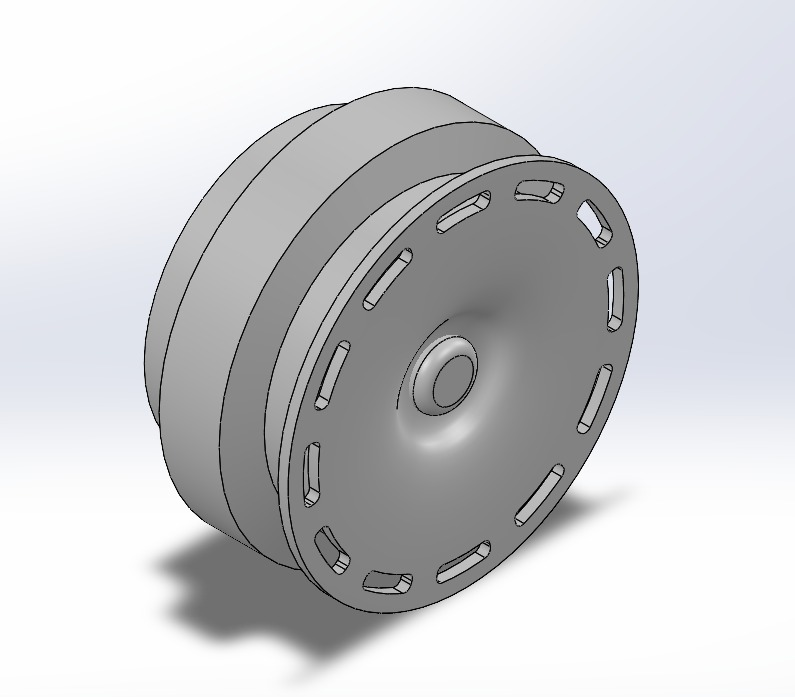
   <em>Wheel rim — SolidWorks model.</em>

  
   <em>The wheels installed on the assembled robot.</em>

## The underside

The bottom view is useful because it shows parts that are difficult to see from above: the lower chassis area, wheel arrangement, motor and the electronics mounted underneath. It gives a better idea of how the available space is used.

  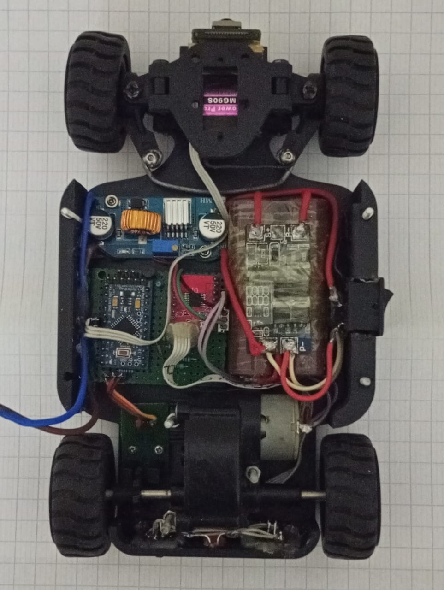
   <em>Assembled robot — underside.</em>

## SolidWorks part files

The original part files are included so the models can be opened and inspected in SolidWorks:

| File | What it represents |
|---|---|
| [chassis.SLDPRT](chassis.SLDPRT) | Main chassis plate |
| [chassis_top.SLDPRT](chassis_top.SLDPRT) | Upper chassis plate |
| [backward.SLDPRT](backward.SLDPRT) | Rear structural part |
| [left-cover.SLDPRT](left-cover.SLDPRT) | Curved cover / side panel |
| [rim.SLDPRT](rim.SLDPRT) | Wheel rim |
| [encoder.SLDPRT](encoder.SLDPRT) | Encoder-related mechanical part |

The images in this folder are CAD renders and photographs of the assembled robot. The SolidWorks files contain the editable part geometry. The renders are useful for viewing the shapes, while the real photographs show how the parts and hardware come together on the car.
