# InnoBots — WRO Future Engineers 2026

<p align="center">
  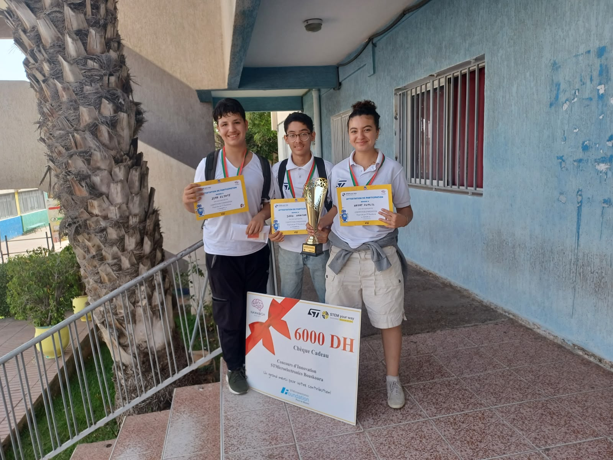
</p>

<p align="center"><strong>One team. One robot. A lot of ideas, tests, and engineering.</strong></p>

We're **InnoBots**, a team from **Ibn Mandour High School, Morocco**, competing in **WRO Future Engineers 2026**. This repository presents our robot, its mechanical and electrical design, the firmware, and our competition journey.

---

## Meet the robot

The following photographs show the robot from six sides.

<table>
  <tr>
    <td align="center"><strong>Front</strong><br>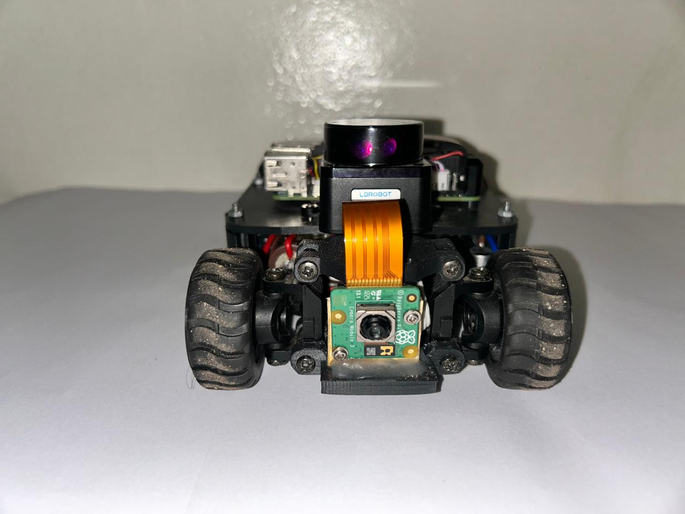</td>
    <td align="center"><strong>Back</strong><br>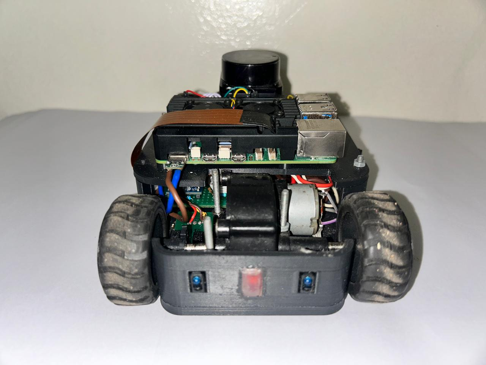</td>
  </tr>
  <tr>
    <td align="center"><strong>Left</strong><br>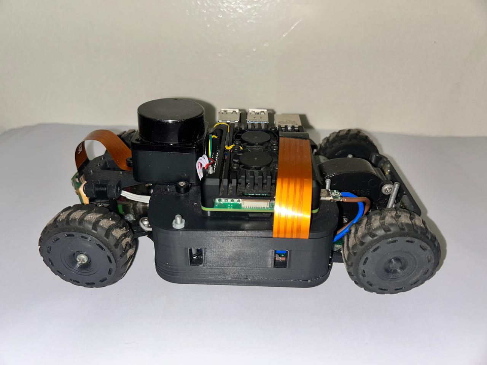</td>
    <td align="center"><strong>Right</strong><br>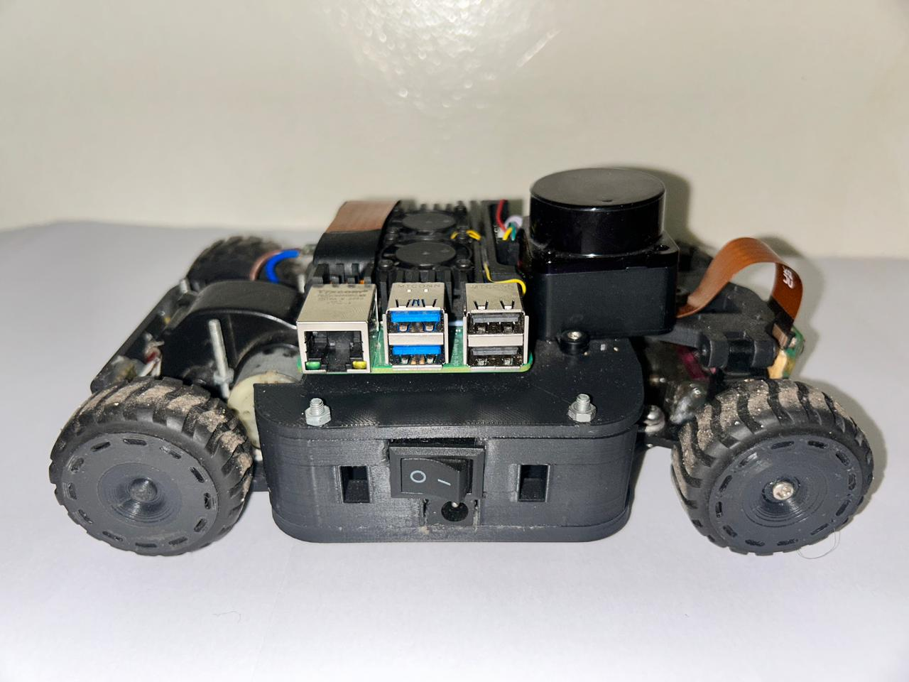</td>
  </tr>
  <tr>
    <td colspan="2" align="center"><strong>Top</strong><br>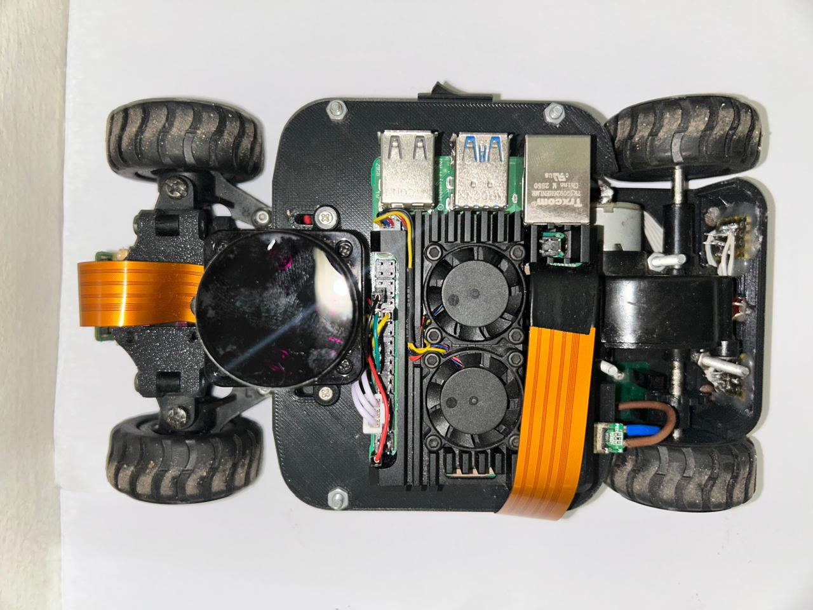</td>
  </tr>
  <tr>
    <td colspan="2" align="center"><strong>Bottom — chassis underside</strong><br>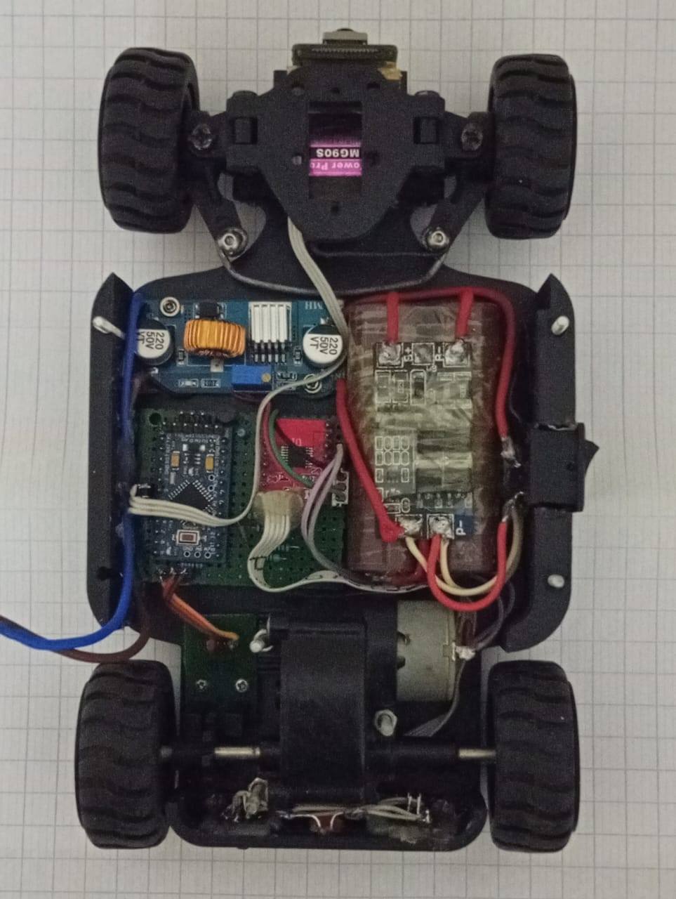</td>
  </tr>
</table>

## The team

<p align="center">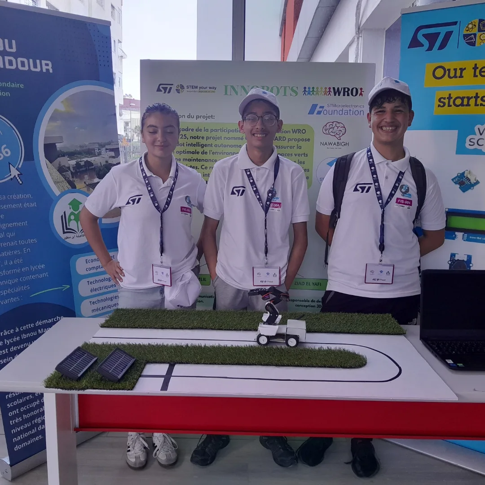</p>

- **Saad Hantar — Team Leader & Electronics:** team coordination, electronics, and hardware integration.
- **Ziad El Yafi — Graphics & Visual Design:** visual identity, graphic design, and project presentation.
- **Hayat Oumlil — Communications:** team communication, outreach, and presentation.

The robot is a shared effort, with all members contributing to engineering decisions and problem-solving.

## Our journey & achievements

The three team members studied together for three years at Ibn Mandour High School in the **Science and Electrical Sciences & Technologies** branch. After high school, we continued our studies at different schools while remaining together as a team.

- **WRO 2026 — Future Engineers: 1st Place.**
  <p align="center">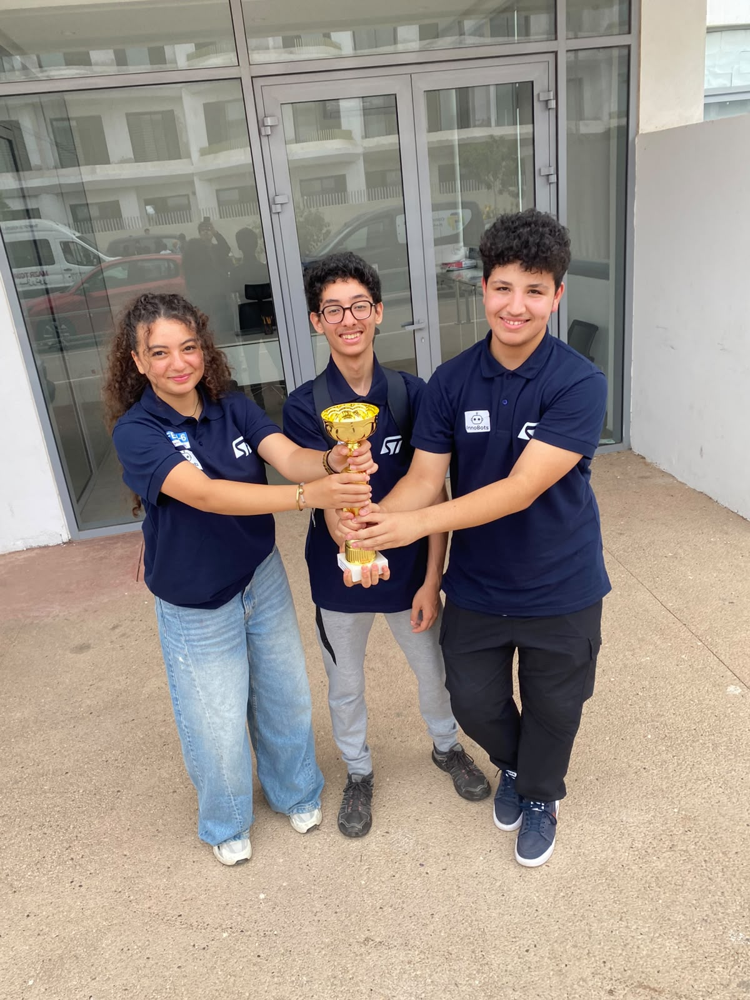</p>
- **WRO 2025 — Future Innovators: 3rd Place.**
- **WRO Open Championship — Slovenia: Qualified.** The team qualified but was unable to attend.
- **MRNC 2026 — Winner.**
  <p align="center">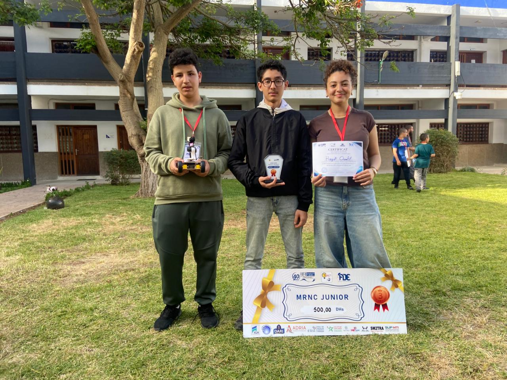</p>
- **Nawabigh ST — Winner.**
  <p align="center">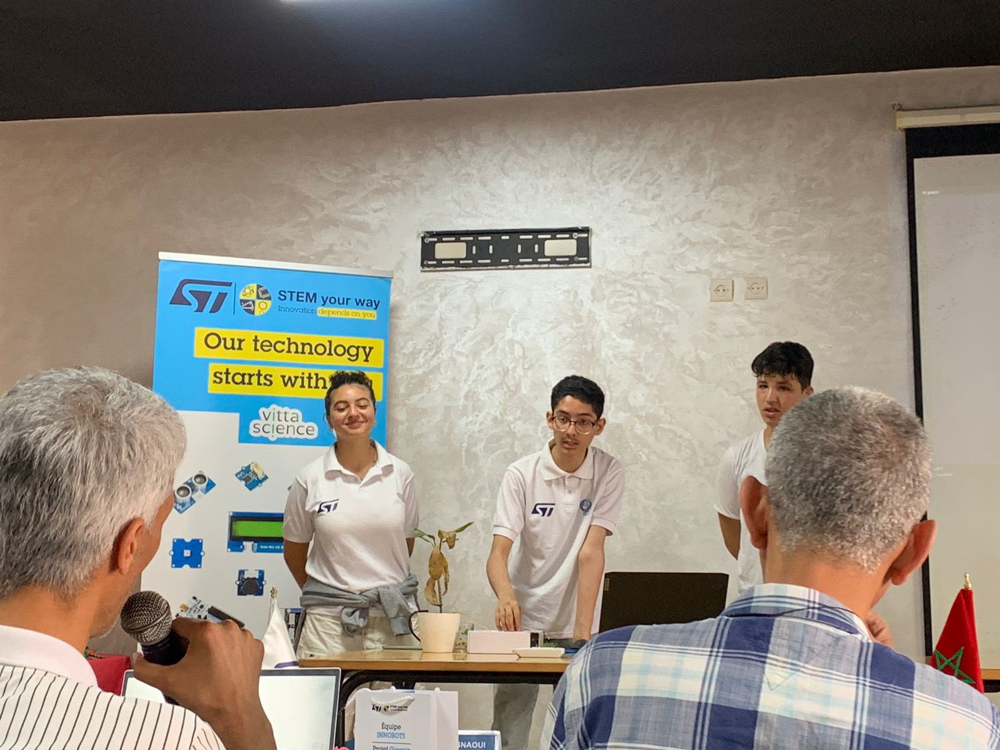</p>

Follow our updates on [Instagram — @innob.ots](https://www.instagram.com/innob.ots/).

---

## Repository structure

| Folder / file | Description |
|---|---|
| [Code/](Code/) | Arduino firmware modules for motor control, steering, and serial communication |
| [Mech/](Mech/) | SolidWorks part models and mechanical design renders |
| [Elec/](Elec/) | Electrical architecture and power-management documentation |
| [docs/](docs/) | Parts inventory and motor-selection / torque-analysis references |
| [v-photos/](v-photos/) | Robot photographs from different angles |
| [t-photos/](t-photos/) | Team and competition photographs |

## 1. Mechanical design

The robot's mechanical structure is designed around a compact chassis, mounted components, and wheel assemblies. The SolidWorks models in [Mech/](Mech/) represent the main structural and drivetrain-related parts. The design uses mounting holes, raised standoffs, slots, and shaped covers to organize the components and provide attachment points.

### CAD components

| SolidWorks part | Design role |
|---|---|
| [chassis.SLDPRT](Mech/chassis.SLDPRT) | Main structural chassis plate. Its perimeter and mounting holes provide the base for the robot's components. |
| [chassis_top.SLDPRT](Mech/chassis_top.SLDPRT) | Upper chassis plate / mounting layer. The model includes raised mounting bosses and elongated slots for component attachment. |
| [backward.SLDPRT](Mech/backward.SLDPRT) | Rear structural or mounting component, shaped to fit the rear section of the chassis. |
| [left-cover.SLDPRT](Mech/left-cover.SLDPRT) | Side cover or protective panel with openings for mechanical access or mounting. |
| [rim.SLDPRT](Mech/rim.SLDPRT) | Wheel rim model, with a central hub and openings distributed around the wheel face. |
| [encoder.SLDPRT](Mech/encoder.SLDPRT) | Encoder-related mechanical part used in the drivetrain / motor-feedback assembly. |

### Mechanical CAD views

The following renders show the geometry of the individual parts. They are visual CAD views rather than dimensioned manufacturing drawings.

<p align="center">
  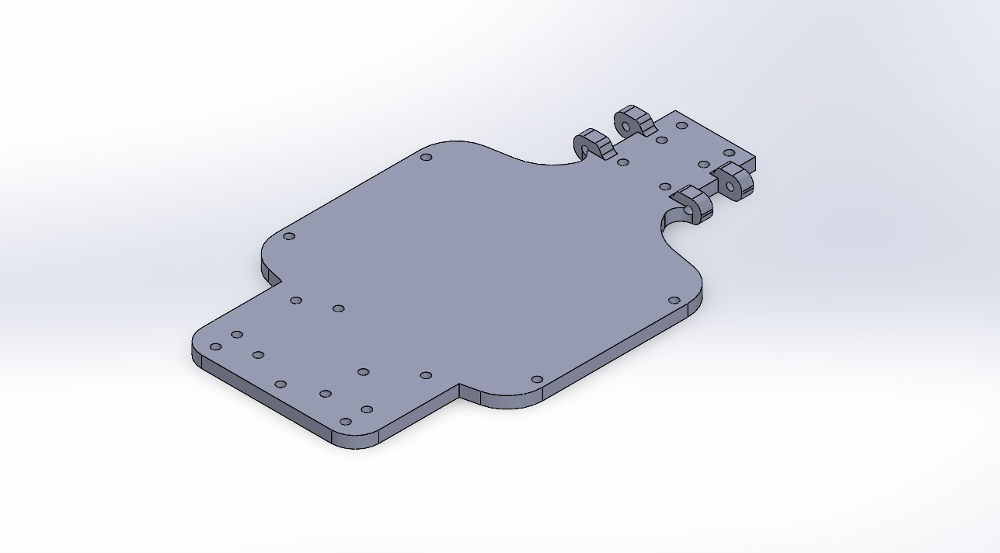
  <br><em>Main chassis plate with perimeter mounting holes and rear mounting features.</em>
</p>

<p align="center">
  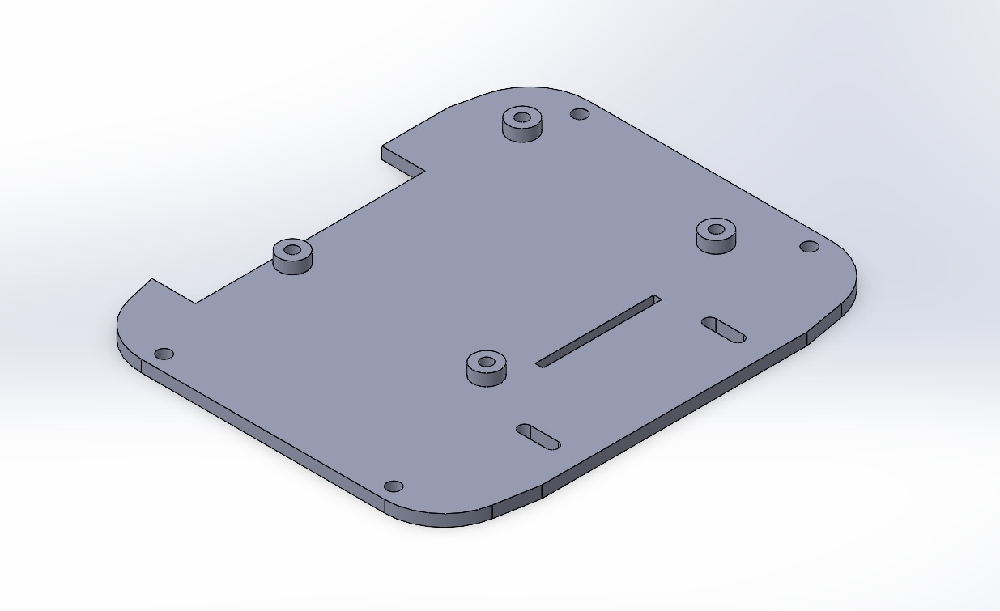
  <br><em>Upper chassis plate showing raised mounting bosses and elongated slots.</em>
</p>

<p align="center">
  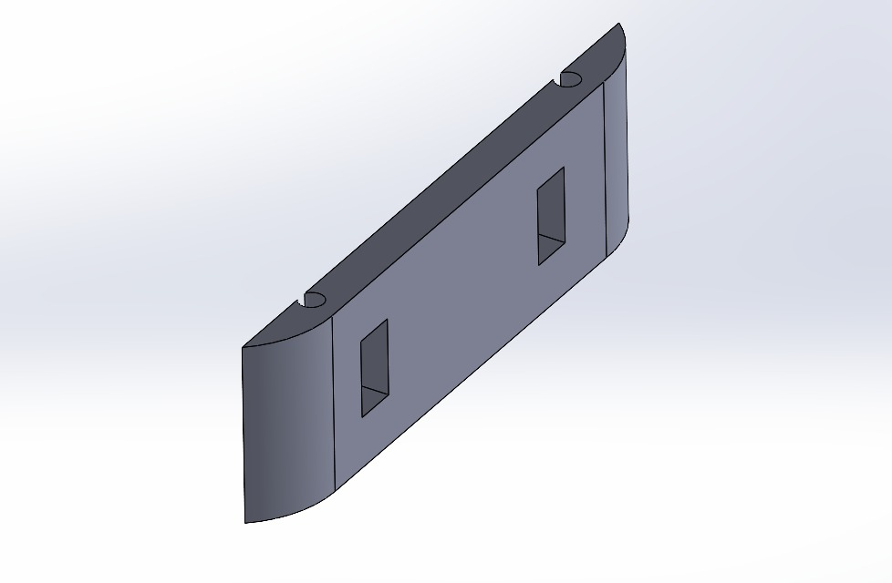
  <br><em>Side structural component with mounting openings.</em>
</p>

<p align="center">
  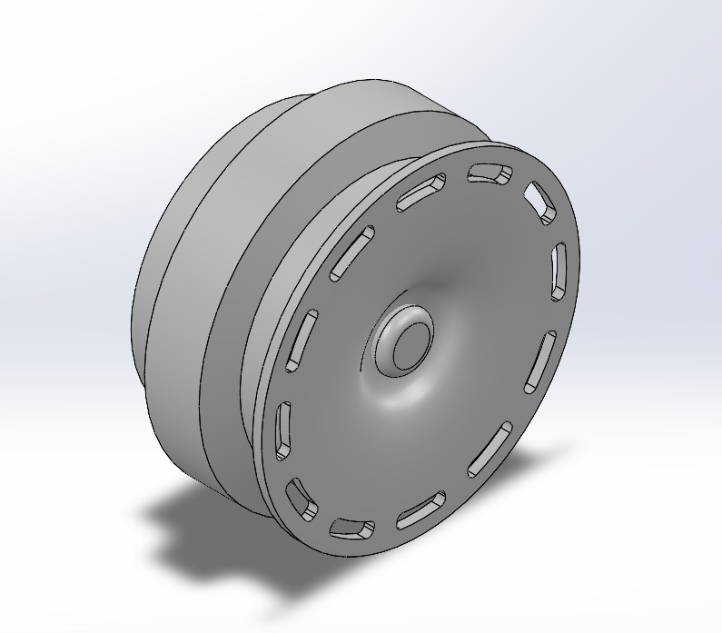
  <br><em>Wheel rim with central hub and circumferential openings.</em>
</p>

<p align="center">
  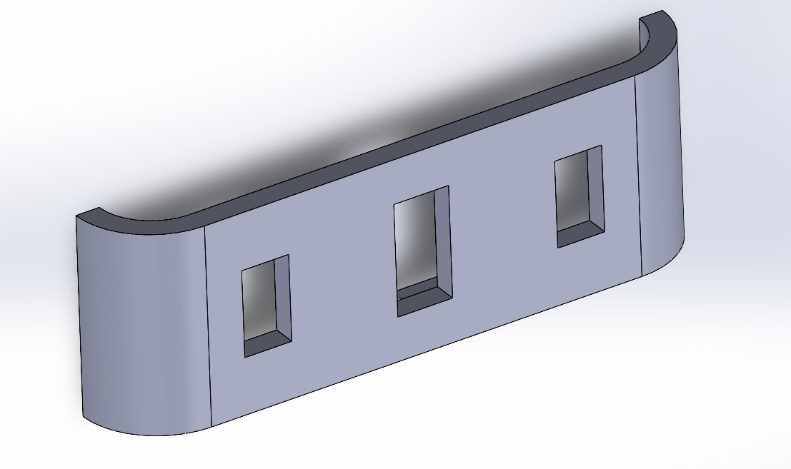
  <br><em>Curved cover / structural panel with rectangular openings.</em>
</p>

The original SolidWorks part files are retained in the [Mech folder](Mech/) so the geometry can be opened and inspected in compatible CAD software.

### Dimensions and mobility

The documented compact envelope is approximately **115 mm × 196 mm**. The compact footprint supports maneuverability in the competition course while keeping the mechanical layout organized.

### Drive motor selection

The selected drive motor is the **RE-260RA-2670 DC motor** with a stated **17:1 reduction ratio**. The team's motor-selection reference lists a 3.0 V operating point. At the listed maximum-efficiency point (10,200 rpm and 1.5 mN·m), an 80% gearbox-efficiency assumption gives an estimated output speed of 600 rpm and output torque of 20.4 mN·m. With 44 mm diameter wheels, the corresponding theoretical linear speed is approximately 1.38 m/s.

<p align="center">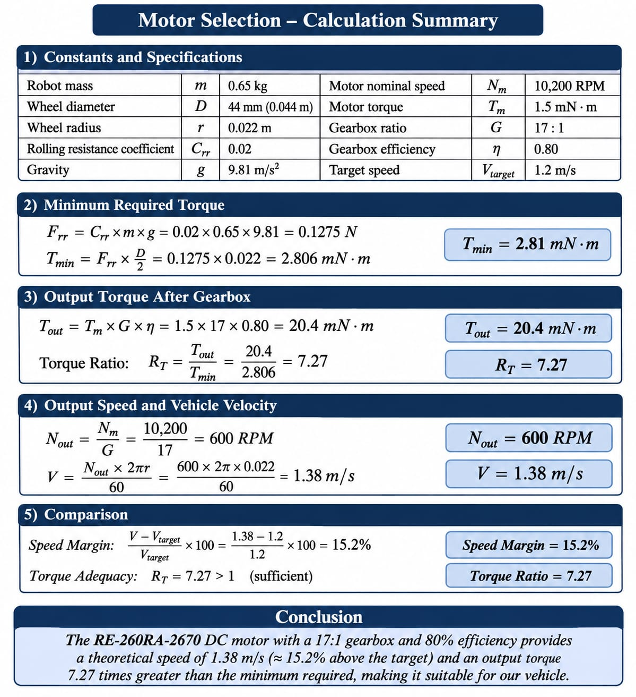</p>
<p align="center"></p>

The component inventory and the team's torque calculation are documented in [docs/parts-list.md](docs/parts-list.md).
## Steering method: Ackermann

We chose **Ackermann steering** because the inside front wheel must turn more sharply than the outside wheel during a turn. This helps both front wheels follow their own path with less tire slipping, making turns smoother and more controlled.

Our Arduino sends one steering command to a servo. The mechanical linkage determines how that command moves the front wheels. The steering angle is controlled by a PID loop, with the servo centered at 90° and limited to 45°–150°.

## 2. Electronics, power & sensors

The electronics connect the controller, motor driver, sensors, and battery. The project hardware inventory includes:

- **Raspberry Pi 5** — main computing platform.
- **Raspberry Pi Camera Module 3** — visual sensing.
- **D500 LiDAR** — distance sensing.
- **Arduino Pro Mini** — low-level control.
- **Encoder** — motor-speed feedback.
- **DRV8833** — DC motor driver.
- **MG90S servo** — steering actuator.
- **2S battery pack, 2S BMS, and XL4015 converter** — power source, battery protection, and voltage regulation.
- 
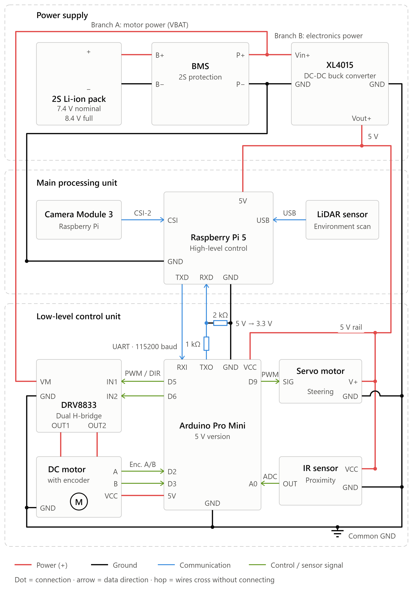

### Firmware pin assignments

The following assignments are defined in the current source files:

### Firmware pin assignments

| Arduino pin | Function | Source |
|---|---|---|
| D3 | Motor encoder input; rising-edge interrupt | `motor.cpp` |
| D5 | Motor driver output 1 (PWM) | `motor.cpp` |
| D6 | Motor driver output 2 (PWM) | `motor.cpp` |
| D9 | Steering servo signal | `steering.cpp` |
| A0 | Battery voltage sensor input | `power.cpp` |
| A1 | Current sensor input | `power.cpp` |
| A2 | Left rear sensor input | `back_sensor.cpp` |
| A3 | Right rear sensor input | `back_sensor.cpp` |
| GPIO 18 | Arduino reset control during upload | `flash.sh` |
| `/dev/ttyAMA0` | Serial connection to Raspberry Pi; runtime set to 115200 baud | `myserial.py`, `uart.cpp` |


### Power architecture

The power-management document describes a 2S battery-based architecture with battery protection, a main switch and fuse, a regulated supply for low-voltage electronics, and a motor-driver supply. The power budget is an estimate based on the project values, not a laboratory measurement.

See [Elec/POWER_MANAGEMENT.md](Elec/POWER_MANAGEMENT.md) for the block diagram and load estimate.

## 3. Software architecture

- **Raspberry Pi (Python):** reads the camera and LiDAR, decides the speed and steering error, then sends commands over serial.
- **Arduino (C++):** receives those commands and controls the motor and steering servo.

## Project structure

```text
Code/
├── py_code/
│   ├── main.py                  # Main autonomous driving loop
│   ├── camera.py                # Camera capture and color/object detection
│   ├── lidar.py                 # LiDAR scans, obstacle detection, steering estimate
│   ├── myserial.py              # Serial connection and command transmission
│   └── colors_hsv_config.json   # HSV color thresholds used by camera.py
└── cpp_code/
    ├── main/                    # Arduino sketch and hardware modules
    │   ├── main.ino             # Arduino startup and loop
    │   ├── uart.cpp / uart.h    # Receives and parses Pi commands
    │   ├── motor.cpp / motor.h  # Motor output and encoder RPM measurement
    │   ├── steering.cpp / steering.h # PID steering and servo output
    │   ├── back_sensor.cpp / back_sensor.h # Rear analog sensors
    │   └── power.cpp / power.h  # Battery voltage and current-sensor helpers
    └── flash.sh                 # Compile and flash helper for Raspberry Pi
```

## Python code: Raspberry Pi

### `main.py` — system coordinator

This is the program entry point and the high-level driving logic. It starts the LiDAR and camera workers, then repeatedly:

1. Sets the requested motor speed and PID gains.
2. Checks `camera.camera_obstacle()` for a red or green object and its horizontal image error.
3. If a camera object is detected while LiDAR reports an obstacle, chooses a strong steering direction based on its color (red steers one way, green the other).
4. Otherwise, uses the camera error, or the LiDAR left/right distance error, as the steering request.
5. Sends `motorSpeed,steerError,Kp,Ki,Kd` to the Arduino.


### `camera.py` — vision and color detection

Uses Picamera2 to capture 1280×720 frames on a background thread. Each frame is rotated 180 degrees, converted from RGB to HSV, and thresholded using `colors_hsv_config.json`. It applies a morphological opening to reduce small noise and displays the camera image and color masks in OpenCV windows.

`camera_obstacle()` examines red and green masks, finds contours at least `min_area` pixels large, selects the largest, and returns `(horizontal_error, color)`. The error is the contour center relative to the image center. `start_camera()` initializes capture and the worker; `stop_camera()` stops the worker and releases the camera.

### `lidar.py` — range sensing

Reads LDROBOT STL-19P scans from `/dev/ttyAMA2` on a background thread. Valid polar scan points are converted into Cartesian `(x, y)` coordinates and shared with the rest of the program under a lock.

- `lidar_obstacle()` checks for points in the forward region `-55 < x < 55` mm and `40 < y < 250` mm.
- `left_obstacle()` and `right_obstacle()` check the corresponding sides of that region.
- `lidar_error()` computes the difference between average left and right point distances; positive/negative values provide a steering cue.
- `get_cordonates()` returns a copy of the latest point list (function spelling retained from source).

### `myserial.py` — Pi-to-Arduino link

Opens a pySerial connection on `/dev/ttyAMA0` at 115200 baud. `write_to_serial(data)` appends a newline and writes the command as UTF-8, matching the Arduino line-based parser.

### `colors_hsv_config.json` — vision thresholds

Stores lower and upper HSV bounds (six values per color) for Red, Green, Blue, Orange, and Magenta. These values are loaded by `camera.py`; red and green are the colors currently used by `camera_obstacle()`.

## Arduino code: motor and steering controller

### `main.ino` — Arduino lifecycle

`setup()` initializes UART, motor outputs/encoder, and steering servo, then commands zero speed. Each `loop()` reads any available serial command, updates steering, and applies the current motor speed.

### `uart.cpp` / `uart.h` — command parser

Defines the shared command values (`motorSpeed`, `steerError`, and PID gains), starts hardware serial, and parses incoming newline-terminated CSV commands. `update_serial()` expects exactly five comma-separated fields in this order:

```text
motorSpeed,steerError,Kp,Ki,Kd
```

The header declares these globals so the steering and main modules can use them.

### `motor.cpp` / `motor.h` — drive motor

Configures PWM outputs on pins 5 and 6 and an encoder input on pin 3. `runSpeed(speed)` selects direction and PWM duty cycle from the sign and magnitude of the requested speed. The encoder interrupt records pulse timing; `currentRpm()` estimates RPM from the pulse period.

### `steering.cpp` / `steering.h` — PID steering

Uses the `PID_v1` library to turn `steerError` into a servo correction. It updates PID tunings when the received `Kp`, `Ki`, or `Kd` changes, limits the correction to the configured servo range, and writes the result to a servo on pin 9. The center angle is 90 degrees; limits are 45 to 150 degrees.

### `back_sensor.cpp` / `back_sensor.h` — rear sensors

Reads two analog sensors on A2 and A3. `backError()` returns right sensor reading minus left sensor reading. These functions are available to other code, but are not called from the current `main.ino` loop.

### `power.cpp` / `power.h` — power sensing helpers

Initializes analog inputs A0 (battery) and A1 (current sensor). `battery_voltage()` estimates battery voltage from A0 with a fixed offset. `pi_current()` contains current-sensor conversion constants, but currently returns the raw ADC reading rather than the calculated current. Neither helper is used by the current main loop.

### `flash.sh` — Arduino build/upload helper

For Raspberry Pi/Linux: compiles the sketch with `arduino-cli`, toggles GPIO 18 for reset, then uploads the HEX using `avrdude` through `/dev/ttyAMA0`. It expects the sketch directory as its argument, for example `./flash.sh main` from `cpp_code`.

## Command flow

```text
Camera + LiDAR → main.py decision loop → CSV over UART → uart.cpp parser
                                                       ├── motor.cpp → drive motor
                                                       └── steering.cpp → steering servo
```


## Competition videos

Here are two videos showing our robot on the course during the WRO Future Engineers 2026 challenges.

- **Open Challenge:** [Watch our run on YouTube](https://youtu.be/mYlt0tB4ghc)
- **Obstacle Challenge:** [Watch our run on YouTube](https://youtu.be/6qGnksUF9Dk)

## 4. Obstacle Management and Navigation

This document explains how the vehicle uses LiDAR, camera color detection, and track-line counting to navigate the WRO Future Engineers course.

## Navigation overview

The navigation system combines three kinds of information:

1. **LiDAR distance points** estimate the free space around the front of the car and provide a steering correction.
2. **Camera color detection** locates red and green obstacles in the image and steers around them when they are close.
3. **Orange and blue line counting** tracks course turns/laps using a boolean flag-based counter.

The Raspberry Pi runs perception and decision-making. It sends motor speed, steering error, and PID gains to the Arduino. The Arduino turns the steering error into a servo angle and applies the requested motor speed.

## LiDAR: scan points and steering error

### Polar to Cartesian conversion

The LiDAR provides each valid measurement as a distance `r` in millimeters and an angle `θ` in degrees. In `lidar.py`, each scan point is transformed to the car-relative Cartesian coordinate system:

```python
x = r * cos(θ)
y = -r * sin(θ)
```

The angle is converted from degrees to radians before calling Python's `sin` and `cos` functions. The negative sign on `y` defines the coordinate orientation used by this program. The resulting `(x, y)` points are stored as the latest scan coordinates. In this code's frame, points with `y > 0` are treated as being in front of the car; negative `x` is the left side and positive `x` is the right side.

> **Figure placeholder — LiDAR coordinate frame**  
> Add a top-down picture of the car showing the LiDAR origin, positive `x` to the right, positive `y` forward, a measured point at distance `r`, angle `θ`, and the projections `x = r cos(θ)` and `y = -r sin(θ)`. Label the vehicle's left and right sides to match the signs used in `lidar.py`.

### Obstacle detection

`lidar_obstacle()` checks whether any point falls in a rectangular region directly ahead:

```text
-55 mm < x < 55 mm
 40 mm < y < 250 mm
```

If at least one point is inside this region, the function reports a forward obstacle. `left_obstacle()` and `right_obstacle()` test the left and right halves of a similar forward region.

### LiDAR steering error from left/right averages

`lidar_error()` considers points in front of the car (`y > 0`) and separates them by side:

- Left set: points with `x < 0`
- Right set: points with `x > 0`

For each point, the program calculates its distance from the LiDAR origin using the Euclidean distance (hypotenuse):

```text
d = sqrt(x² + y²)
```

It calculates the average distance on each side, then subtracts the left average from the right average:

```text
left_average  = average(distance of left-side points)
right_average = average(distance of right-side points)
steering_error = right_average - left_average
```

This gives a signed correction based on the difference in nearby space on either side. The error is sent to the Arduino, where the steering PID uses it to adjust the servo. If either side has no points, `lidar_error()` returns `None`; callers should handle that case before building a serial command.

## Camera: red and green obstacle avoidance

### HSV masks

`camera.py` captures frames with Picamera2, rotates each image 180 degrees, and converts RGB pixels to HSV with OpenCV. For each configured color, it creates a binary mask using the lower and upper HSV thresholds in `colors_hsv_config.json`:

```python
mask = cv2.inRange(hsv, lower, upper)
```

Pixels within the configured color range are selected in the mask; other pixels are excluded. A 5×5 morphological opening removes small isolated regions/noise. The current obstacle decision uses the red and green masks. The camera code also displays the frame and color masks in OpenCV windows for tuning and observation.

> **Figure placeholder — camera color masks**  
> Add a screenshot showing the camera view and the red/green binary masks generated by OpenCV. Include an example with a detected red obstacle and another with a detected green obstacle.
>
> ``

### Object location and image-center error

`camera_obstacle()` finds contours in the red and green masks, ignores contours smaller than `min_area`, and selects the largest remaining contour. It calculates that contour's horizontal center (`center_x`) and compares it with the image center:

```text
camera_error = center_x - image_center_x
```

The returned pair is `(camera_error, color)`. This error indicates whether the obstacle appears left or right of the center of the camera image. The controller uses the position error to keep the detected obstacle near the chosen center line of view while approaching/aligning.

### Close obstacle steering choice

In `main.py`, when a red/green obstacle has been detected and LiDAR also reports an obstacle in the forward zone, the controller selects a strong avoidance direction based on the color:

- **Red obstacle:** steer right.
- **Green obstacle:** steer left.

The source expresses these choices as large signed steering errors (`+1000` for red and `-1000` for green), which the Arduino PID/servo limits constrain to the available steering range. When the close-obstacle condition is absent, the controller uses the camera image error or the LiDAR steering error instead.

## Course turns and lap counting with colored lines

The course navigation logic counts orange and blue line detections to determine turn/lap progress. The intended counter is **boolean flag-based**: a detected line changes a flag/state so one physical line crossing is counted once, rather than incrementing on every camera frame while the line remains visible. After the line is no longer detected, the flag is reset/armed so a later crossing can be counted. Orange and blue detections can be tracked separately to identify the sequence of course markers and decide when to execute the corresponding turn.

A simplified state pattern is:

```text
line not detected → armed
line detected while armed → count once, disarm
line remains detected → do not count again
line clears → re-arm for the next crossing
```

The supplied `camera.py` configures HSV thresholds for orange and blue, but its current `camera_obstacle()` function only searches for red and green. The supplied `main.py` also does not contain the orange/blue line counters or turn-state logic. Add or link the implementation here when that navigation code is included, and document the exact marker sequence and turn actions used by the vehicle.

## Data flow

```text
LiDAR scan ── polar-to-Cartesian points ── obstacle zone + left/right averages ─┐
                                                                               ├─ main.py ── UART command ── Arduino PID/servo + motor
Camera frame ── HSV masks ── red/green object center + color ──────────────────┤
Camera frame ── orange/blue line state/counting (navigation logic) ────────────┘
```

## Related source files

- `py_code/lidar.py` — coordinate conversion, obstacle zones, and left/right distance error.
- `py_code/camera.py` — HSV masks, contour selection, and red/green image-center error.
- `py_code/colors_hsv_config.json` — HSV bounds for red, green, blue, orange, and magenta.
- `py_code/main.py` — combines camera and LiDAR results and sends the steering command.
- `cpp_code/main/steering.cpp` — applies PID steering correction and commands the servo.

### Hardware documentation

The component list and the team's motor-selection and torque calculations are included in [docs/parts-list.md](docs/parts-list.md). The power distribution concept is described in [Elec/POWER_MANAGEMENT.md](Elec/POWER_MANAGEMENT.md). These are project design notes and calculations; the competition rules and Arduino links above are external references for the challenge requirements and programming concepts.
## 5. Building and project files

- Mechanical part models are stored in [Mech/](Mech/).
- Electrical architecture is documented in [Elec/](Elec/).
- Firmware source files are stored in [Code/](Code/).
- Component information and motor calculations are in [docs/parts-list.md](docs/parts-list.md).

The `.SLDPRT` files are native SolidWorks part documents. The repository also includes rendered CAD views to make the geometry easier to review without opening the CAD files.

---

<p align="center">
  <strong>Built by InnoBots · Ibn Mandour High School · Morocco</strong><br>
  <em>Think together. Build together. Test. Improve. Repeat.</em>
</p>
