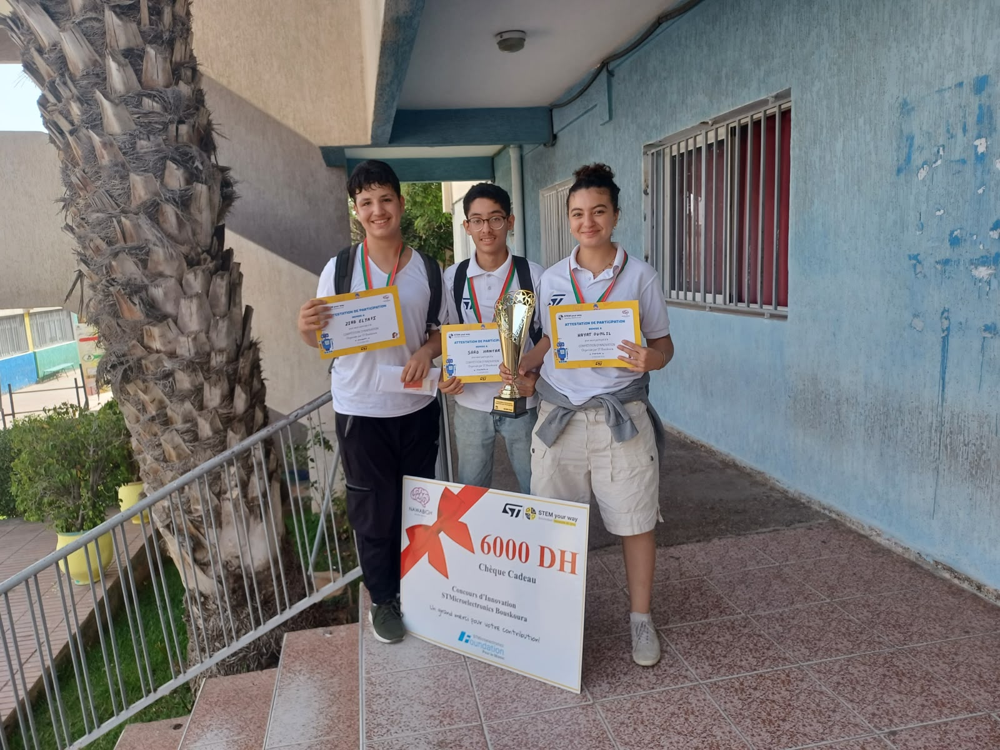
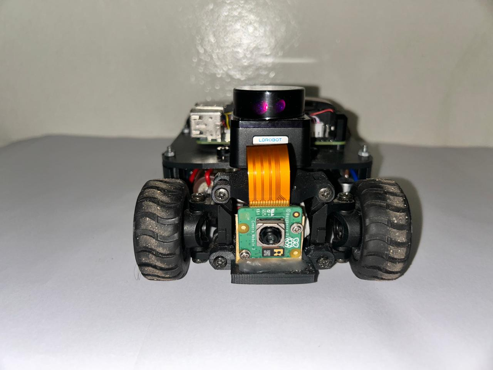
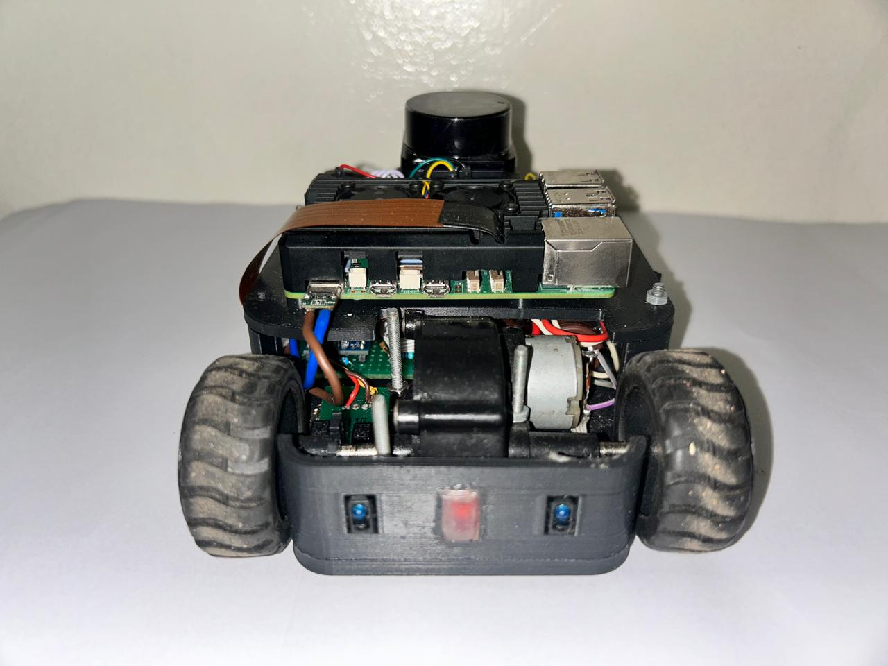
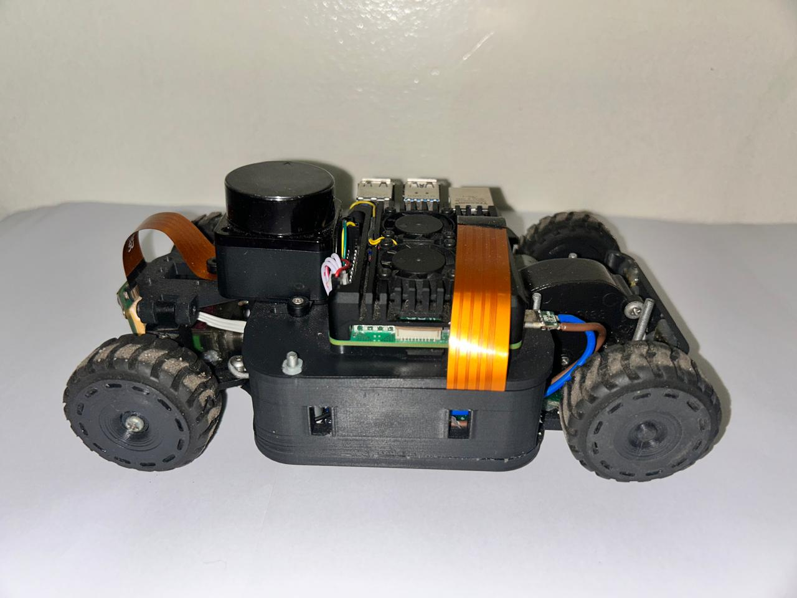
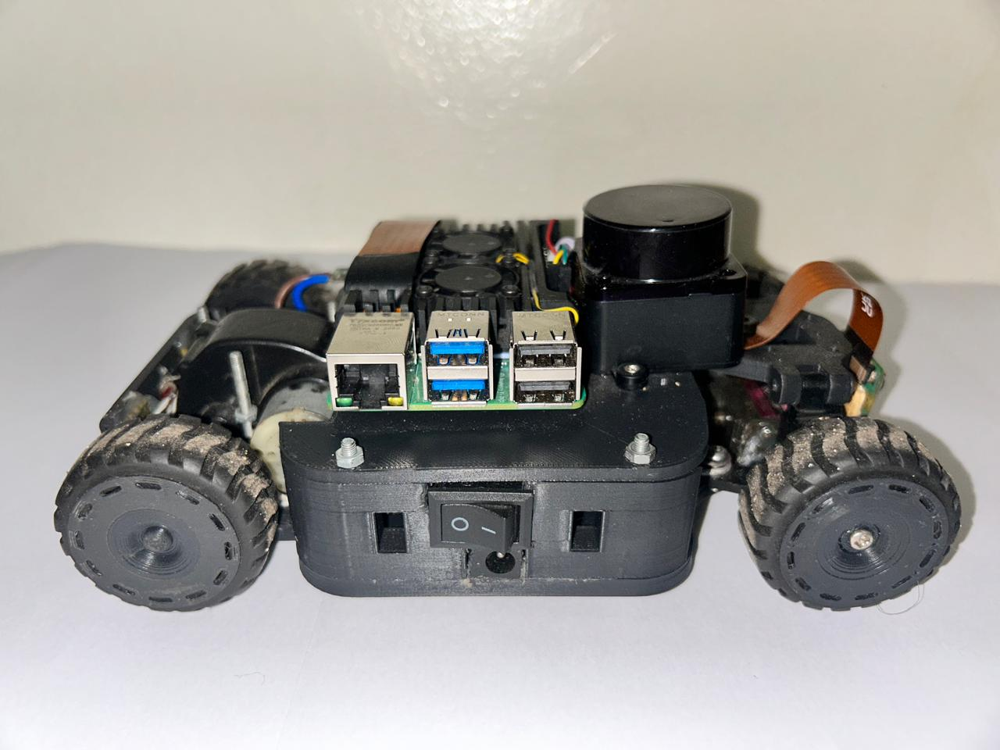
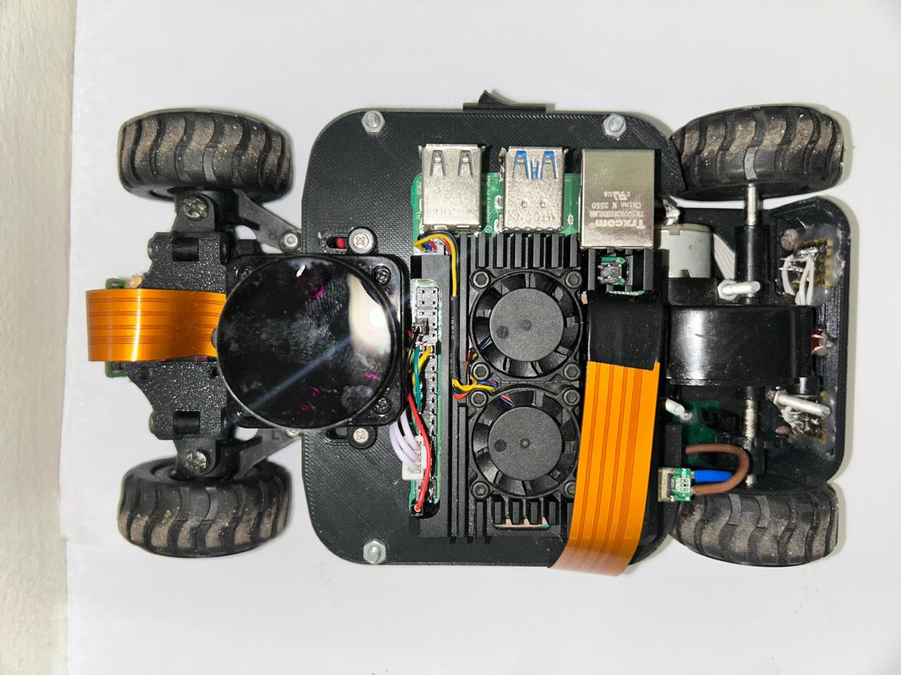
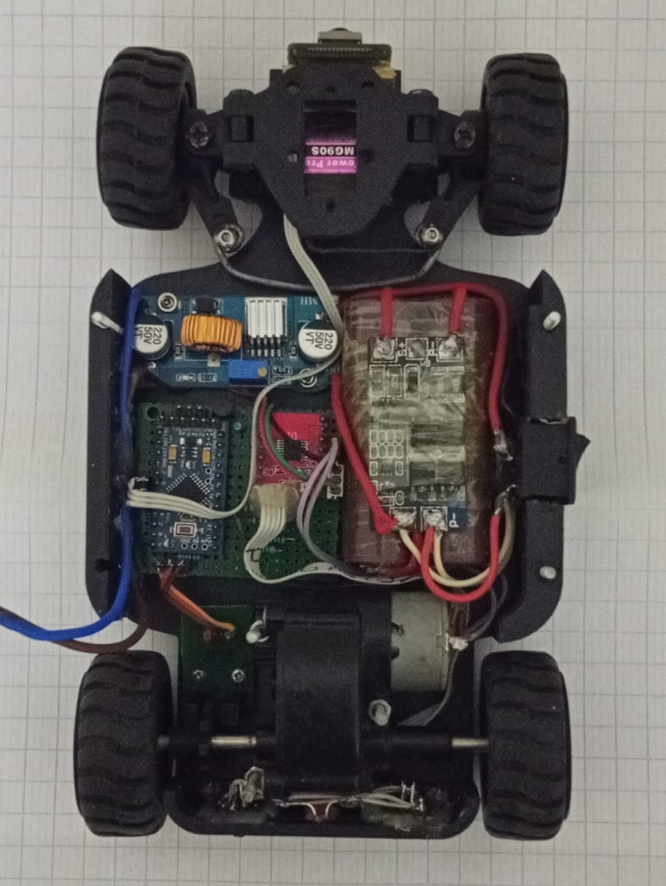
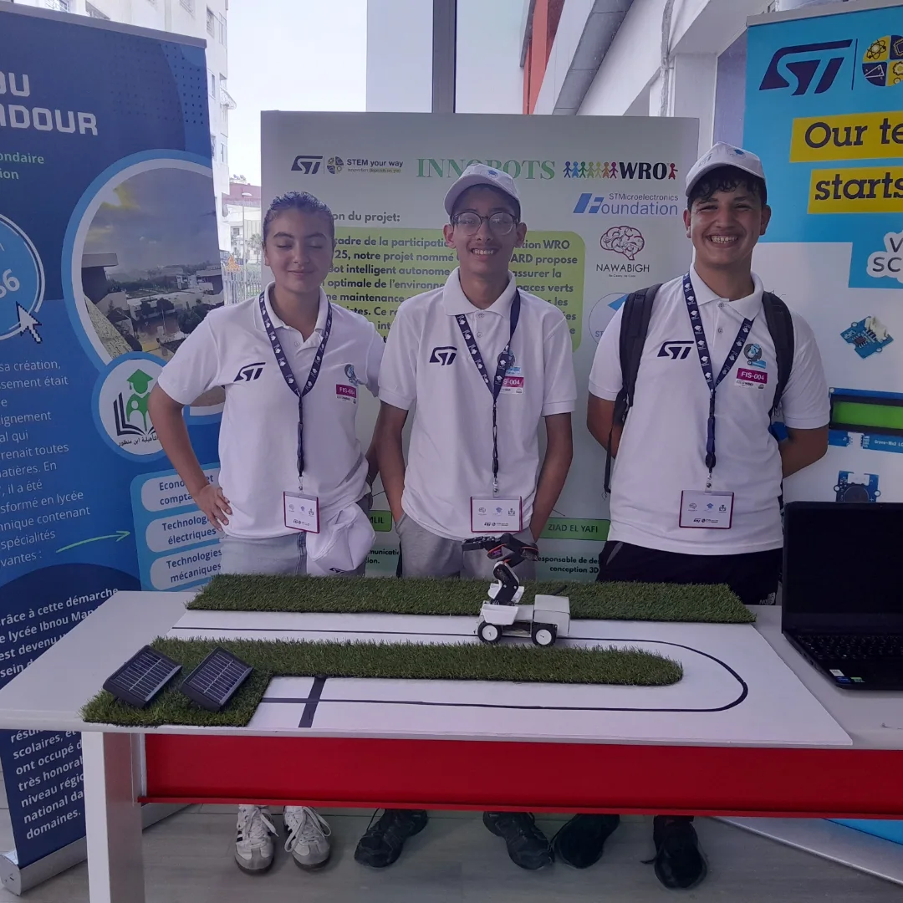
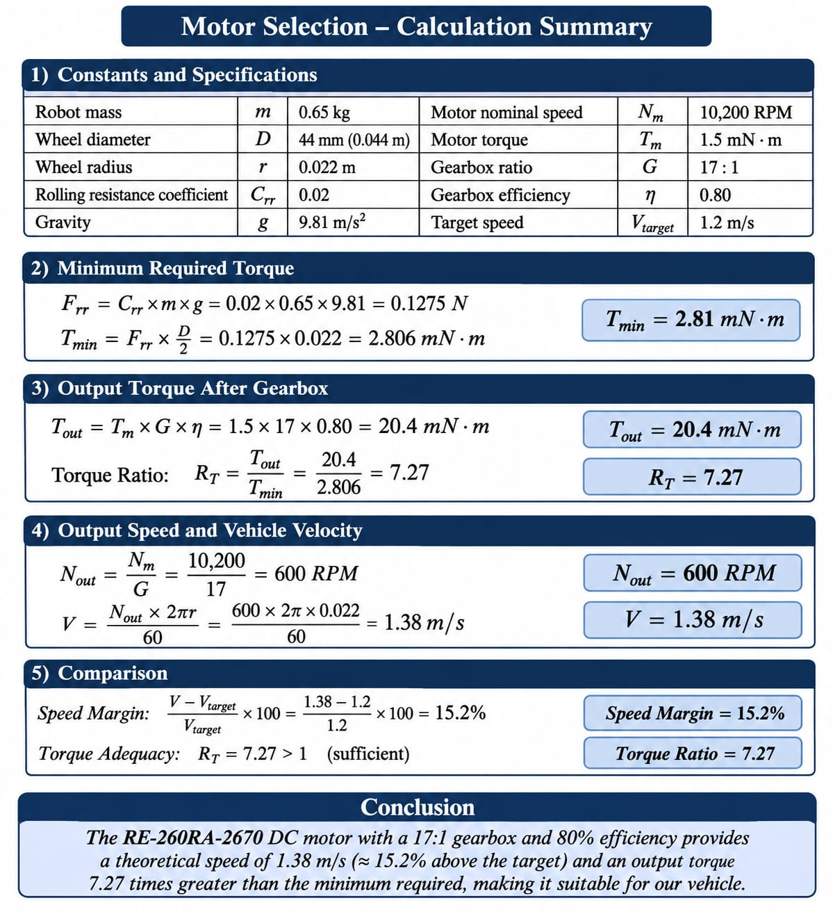
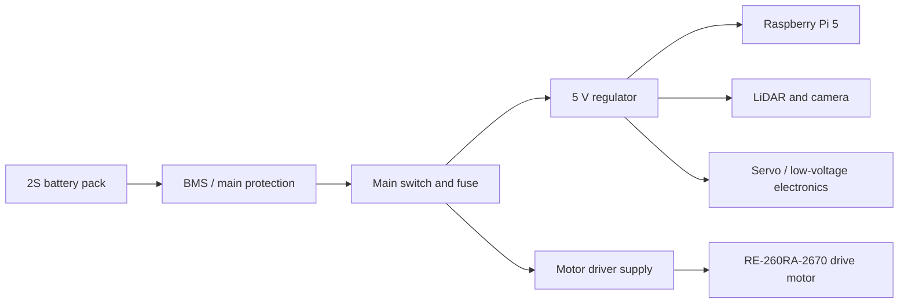

# InnoBots — WRO Future Engineers 2026

<p align="center">
  
</p>

<p align="center">
  <strong>One team. One robot. A lot of ideas, tests, fixes, and probably a few late nights.</strong>
</p>

Hey! We're **InnoBots**, a team from **Ibn Mandour High School, Morocco**, taking on the **WRO Future Engineers 2026** challenge.

This is where we're putting our work: the robot we're building, the code that makes it move, the mechanical and electrical choices behind it, and the things we learn along the way. We want this repository to feel like a look inside our workshop, not just a folder full of files. So we'll show the good decisions, the experiments, the problems we still need to solve, and the little details that make this robot ours.

We're still developing the project. Some sections below describe code that is already in the repository; others are our documentation roadmap. Whenever something is not built, tested, or measured yet, we'll say so. We'd rather be honest about where we are than pretend the robot is finished.

---

## Meet the robot

Six views, one machine, countless details still being improved. Here is the robot as it looks in our current photo set.

<table>
  <tr>
    <td align="center"><strong>Front</strong><br></td>
    <td align="center"><strong>Back</strong><br></td>
  </tr>
  <tr>
    <td align="center"><strong>Left</strong><br></td>
    <td align="center"><strong>Right</strong><br></td>
  </tr>
  <tr>
    <td colspan="2" align="center"><strong>Top</strong><br></td>
  </tr>
  <tr>
    <td colspan="2" align="center"><strong>Bottom — Chassis Underside</strong><br></td>
  </tr>
</table>

These pictures are our starting point for explaining the design. As the build changes, we'll keep the gallery updated so the documentation matches the actual robot.

## The people behind InnoBots

A competition robot may run on motors, batteries, and code, but a team runs on people. InnoBots is the group of students bringing this project to life: sharing ideas, building, programming, checking each other's work, and figuring things out when the first attempt doesn't go as planned.

<p align="center">
  
</p>

### The people behind the robot

**Saad Hantar — Team Leader & Electronics**  
Saad coordinates the team's work and takes a leading role in electronics and hardware integration, helping bring the robot's systems together.

**Ziad El Yafi — Graphics & Visual Design**  
Ziad leads the team's visual identity and graphic design, shaping how InnoBots presents its robot, its work, and its story.

**Hayat Oumlil — Communications**  
Hayat leads team communication and outreach, helping the team share its progress and represent its work clearly.

These roles describe the team's current responsibilities and can evolve as the project develops. The robot is a shared effort: each member contributes to the decisions, problem-solving, and work that move the project forward.

## Our journey & achievements

Our story started before the competitions. The three of us studied together for three years at the same high school, in the **Science and Electrical Sciences & Technologies** branch. During that time, we built a friendship around learning, creating, and taking on technical challenges.

After high school, each member continued their studies at a different school. We stayed together as a team, carrying the experience and trust we had built into new projects and competitions.

Some milestones we are proud of:

- **WRO 2026 — Future Engineers: 1st Place.** We earned first place together, representing the result of our shared work and preparation.
- **WRO 2025 — Future Innovators: 3rd Place.** An earlier milestone in our competition journey.
- **WRO Open Championship — Slovenia: Qualified.** We earned qualification for the Open Championship, although we were ultimately unable to attend.
- **MRNC and ENSET competitions — Winner.** We also report winning at these competitions during 2026.
- **STMicroelectronics competition in Morocco — Winner.** Another achievement that reflects our interest in applying engineering beyond a single competition.

For us, these results are not just titles. Each competition has been an opportunity to learn, work under pressure, improve our ideas, and grow as a team. We will continue adding verified event names, dates, certificates, and photos as we organize that evidence.

You can also follow our updates on [Instagram — @innob.ots](https://www.instagram.com/innob.ots/).

---

## A quick tour of the repository

| Folder / file | What's inside |
|---|---|
| [Code/](Code/) | Our Arduino firmware: motor, steering, and serial communication |
| [Mech/](Mech/) | Mechanical design files and documentation |
| [Elec/](Elec/) | Electrical design and wiring documentation |
| [v-photos/](v-photos/) | Robot photos from different angles |
| [t-photos/](t-photos/) | Team photos |
| [README.md](README.md) | You're reading it! The story and technical guide to our project |

The current code folder contains these files:

```text
Code/
├── main.ino
├── motor.cpp
├── motor.h
├── sterring.cpp
├── sterring.h
├── uart.cpp
├── uart.h
├── power.cpp
└── power.h
```

The spelling `sterring` is kept as it appears in the current filenames, so the links and build instructions match the repository. We may clean up the naming in a future code update.

---

## 1. Mobility & mechanical design

(1): We chose compact dimensions (W × L) to improve the car's control and maneuverability. Its relatively small size allows it to make sharper turns, navigate narrow spaces, and avoid obstacles more easily while maintaining good stability.

(2) We calculated the minimum required torque based on the car's mass (650 g), wheel diameter (44 mm), and an estimated rolling resistance coefficient of 0.02 for rubber wheels on a hard surface. The rolling resistance force was approximately 127.5 mN, resulting in a minimum total wheel torque of 2.81 mN·m. This value represents the theoretical minimum torque required to keep the car moving on a flat surface at constant speed.

<p align="center">
  
</p>

We chose the RE-260RA-2670 DC motor, equipped with a 17:1 reduction gearbox, based on its technical specifications, which are presented in the table below. At the maximum efficiency operating point (10,200 rpm and 1.5 mN·m), and assuming a gearbox efficiency of 80%, the gearbox reduces the output speed to 600 rpm and provides an output torque of 20.4 mN·m. With 44 mm diameter wheels, this corresponds to a theoretical linear speed of 1.38 m/s. Since our target speed is 1.2 m/s, the selected motor provides sufficient speed, with approximately 15.2% additional speed capacity. Furthermore, the available output torque is approximately 7.27 times greater than the previously calculated minimum required torque of 2.81 mN·m, making this motor suitable for our vehicle.

<p align="center">
  
</p>

---

## 2. Electronics, power & sensors

The electrical system is the nervous system of the robot. It connects the controller, motors, sensors, and battery. Neat wiring is not just about making the robot look good: it makes debugging easier and helps avoid failures when the robot is moving.

Our electrical documentation will live in [Elec/](Elec/).

### Pin assignments currently found in the code

These are the pin numbers defined in the firmware right now. They still need to be checked against the real wiring diagram.

| Function | Pin | Source file |
|---|---:|---|
| Motor encoder | D3 | `motor.cpp` |
| Motor driver enable / PWM | D5 | `motor.cpp` |
| Motor direction input 1 | D7 | `motor.cpp` |
| Motor direction input 2 | D4 | `motor.cpp` |
| Steering servo signal | D5 | `sterring.cpp` |

**One thing we need to fix:** D5 is currently assigned to both the motor driver's PWM/enable signal and the steering servo signal. That is a pin conflict in the source code. We'll confirm the actual board and wiring, choose separate pins, and update the code and diagram together before calling the setup complete.

### Power management & distribution

Our electrical design uses a **2S battery pack**, battery protection, and a regulated rail for the Raspberry Pi and other low-voltage electronics. The detailed design and estimated load budget are maintained in [Elec/POWER_MANAGEMENT.md](Elec/POWER_MANAGEMENT.md).

The current power-management draft describes this distribution:



The diagram is a system-level view, not a verified wiring schematic. The power document currently contains design estimates for the battery capacity, discharge rating, current draw, fuse and regulator. Those values must be checked against the actual battery label, BMS, XL4015 module, servo, Pi load and measured current before we rely on the calculated runtime or safety margins.

**Important voltage check:** our motor selection reference is for the RE-260RA-2670 at **3.0 V**, while the current power-management draft shows the drive motor connected to the nominal **7.4 V battery rail**. These two parts of the documentation do not yet agree. We must confirm the actual motor supply arrangement (including any motor-side regulation) before connecting or powering the motor. We also need to confirm whether the battery is Li-ion or Li-Po and replace any assumed capacity/current ratings with the pack's real specifications.

For now, the power budget is a planning estimate, not measured consumption. The verification checklist in [POWER_MANAGEMENT.md](Elec/POWER_MANAGEMENT.md) identifies the measurements still required.

### Sensors

The motor encoder input is visible in the current code. A complete sensor list and placement diagram are not yet documented.

For every sensor we use, we'll explain what it does, why we chose it, where it is mounted, what range or field of view it covers, and how we calibrate it. We'll also explain how its position relates to the robot and the WRO field.

---

## 3. Software — making the robot move

Now for the part that gives the hardware instructions. Our firmware is written in Arduino C++ and split into modules instead of putting everything into one enormous file. That makes it easier to work on one part without losing track of the rest.

### Main program — `main.ino`

The current [main.ino](Code/main.ino) does a basic motor test:

1. Initializes the motor module.
2. Initializes serial communication.
3. Sets the motor direction.
4. Sends the measured motor speed over serial.
5. Sets a speed target and calls the motor update function repeatedly.

This is a starting test program, not yet the complete autonomous competition program.

### Motor control — `motor.cpp`

The motor module is currently the most developed part of the firmware.

It uses an encoder interrupt to record the time between pulses. The function `currentRpm()` uses that pulse period to estimate the motor's rotational speed. If no recent pulse is detected, it reports zero.

The `motorRun()` function updates the PWM command about every 50 ms. It compares the target speed with the measured speed, calculates an error and a derivative term, adjusts the PWM value, limits it to the 0–255 range, and sends it to the motor driver.

We can change the control gains using `setKp()` and `setKd()`. The values in `main.ino` are currently test values; we still need to document proper tuning and measured results.

**A detail worth checking:** the RPM formula includes a factor of 10, which assumes a particular number of encoder pulses per revolution. We need to confirm the encoder specification (and gearbox relationship, if applicable) before treating the RPM reading as calibrated.

### Steering — `sterring.cpp`

The steering module currently attaches a servo and lets the program request an angle. The PID function is only a placeholder at this stage. Once the final steering control is implemented, we'll explain how the target angle is selected and how we keep the steering response stable.

### UART communication — `uart.cpp`

The UART module starts serial communication at **115200 baud**. It can send a line of text and read incoming text until a newline.

The next step is to define a proper message format: what each message means, what units it uses, how often it is sent, and what the robot should do if a message is missing or invalid.

### What comes next in software?

The final software documentation will include a flowchart and explain the real logic used for:

- Following the track and staying within the course.
- Detecting and passing obstacles.
- Handling corners and unexpected sensor readings.
- Deciding which movement command has priority.
- Completing the parking manoeuvre.
- Recovering safely when something doesn't go as expected.

Those behaviours are not demonstrated by the current `main.ino`, so we'll add this section as the autonomous code is developed and tested.

---

## 4. Obstacle strategy & autonomous behaviour

This is where the robot has to do more than simply move forward. It needs to understand what's around it, choose a sensible action, and react safely.

For the final version, we'll document the complete process from sensor input to movement:

1. **Observe:** what the sensors or camera detect.
2. **Interpret:** how the software understands the track, walls, and obstacles.
3. **Decide:** how it chooses a route or passing side.
4. **Act:** how that decision becomes a motor and steering command.
5. **Check:** how it knows whether the manoeuvre worked.

We'll include a state-machine diagram, annotated test images, and examples of difficult situations. We'll also explain what happens when two behaviours disagree — for example, when an obstacle is detected but there isn't enough safe space to pass it.

This part is still being developed and documented. We won't claim an obstacle algorithm is finished until the corresponding code and test evidence are here.

---

## 5. Engineering decisions — why we did it this way

There is usually more than one way to solve a robotics problem. What matters is understanding the trade-offs and choosing a solution that works for our robot, our resources, and the competition.

As the project develops, we'll keep a decision record like this:

| Topic | What we'll explain |
|---|---|
| Drive motor | Why this motor, and how its torque and speed fit our needs |
| Steering | Why this mechanism, and how it affects turning and stability |
| Controller | Why it fits our inputs, outputs, and processing needs |
| Sensors | Why each sensor is useful and where it works best |
| Battery | Why its voltage and capacity are suitable |
| Chassis | How dimensions, weight, and component placement affect movement |

We'll also keep track of problems and changes. A useful engineering story is not "we built it and it worked." It's: **we noticed something, tried a solution, tested it, learned from the result, and improved the design.**

### Risks we need to watch

Some examples we'll check during integration and testing:

- Loose parts or fasteners after repeated driving.
- Motor driver or regulator overheating.
- Battery voltage dropping too low.
- Wiring faults or accidental shorts.
- Encoder readings becoming noisy or inconsistent.
- Sensor misalignment.
- Lost or malformed serial messages.

For each real issue, we'll record how we noticed it, what caused it, and what we changed to prevent it happening again.

---

## 6. Testing — the part that turns ideas into evidence

We want the robot to work reliably, not just once when everything happens to go right. That's why testing needs to be repeatable.

Here are the tests we'll document as the robot develops:

| Test | What we'll measure |
|---|---|
| Motor speed | Requested speed compared with encoder RPM |
| Motor response | Acceleration, steady-state error, and stopping |
| Steering | Requested angle compared with actual wheel angle |
| UART | Correct messages, invalid messages, and communication loss |
| Power | Voltage and current at idle and under load |
| Driving | Successful runs, time, and consistency |
| Obstacle handling | Detection and safe passing results |
| Parking | Final position and repeatability |

For every test, we'll try to record the setup, battery condition, number of attempts, result, and what we changed afterward. Failed tests are part of the story too — they often teach us more than the easy wins.

---

## 7. Building and reproducing our robot

We want another team to be able to understand how our robot is built, not just look at the final photos.

When the hardware package is complete, this is how we'll organize the build information:

1. **Check the parts list.** Confirm the exact motors, controller, sensors, battery, drivers, fasteners, and connectors.
2. **Build the mechanical structure.** Use the CAD files and assembly drawings in `Mech/`.
3. **Wire the electronics.** Follow the verified diagrams in `Elec/`. Check polarity, voltage limits, and connections before powering anything.
4. **Prepare the firmware.** Open `Code/main.ino` in the Arduino IDE, select the correct board and port, and install the libraries used by the final code.
5. **Test one subsystem at a time.** Start with the motor, steering, and serial connection before attempting a full run.
6. **Record the working version.** Note the firmware revision, component versions, calibration values, and any known limitations.

The repository is not yet a complete reproduction package. We still need to add the verified parts list, wiring diagrams, CAD exports, sensor details, and tested autonomous software. We'll keep improving it until the documentation matches the actual robot.

---

## 8. Current progress

Here's our honest snapshot of where the repository stands right now.

| Area | What's here | What's next |
|---|---|---|
| Robot photos | Front, back, left, right, and top views | Add captions and update as the build changes |
| Motor firmware | Encoder feedback and PWM speed-control structure | Verify encoder scaling and tune with test data |
| Steering firmware | Basic servo interface | Resolve pin conflict and complete control logic |
| UART | Basic serial send/receive functions | Define and test the message protocol |
| Power | Draft power architecture and estimated load budget in [Elec/POWER_MANAGEMENT.md](Elec/POWER_MANAGEMENT.md) | Confirm actual battery/regulator ratings, resolve the motor-voltage mismatch, and measure current draw |
| Mechanical | Folder ready for design files | Add CAD, dimensions, and assembly views |
| Electrical | Folder ready for diagrams | Add wiring, component list, and power budget |
| Sensors | Encoder input visible in code | Add full sensor inventory and calibration |
| Autonomous driving | Not yet demonstrated by the current main program | Document and test navigation, obstacle handling, and parking |
| Testing | No measured results documented yet | Add repeatable tests and results |

---

## A few things we still want to do

- [ ] Confirm the exact controller board and hardware list.
- [ ] Fix the D5 motor / steering pin conflict.
- [ ] Verify encoder pulses per revolution and RPM calculations.
- [ ] Finish and test the steering control.
- [ ] Add mechanical CAD and dimensioned drawings.
- [ ] Verify the power-management assumptions, add the final wiring diagram, and record measured current draw.
- [ ] Document sensor placement and calibration.
- [ ] Build and explain the autonomous state machine.
- [ ] Test obstacle handling and parking.
- [ ] Add real test results, iterations, and lessons learned.
- [ ] Keep the photos and documentation up to date.

---

## Follow our progress

This repository will keep changing as InnoBots keeps building. The code, photos, diagrams, and explanations should all tell the same story: what the robot looks like, how it works, and what we learned while making it work.

Thanks for stopping by and checking out our project. We're InnoBots, and this is our road to WRO Future Engineers 2026.

<p align="center">
  <strong>Built by InnoBots · Ibn Mandour High School · Morocco</strong><br>
  <em>Think together. Build together. Test. Improve. Repeat.</em>
</p>
