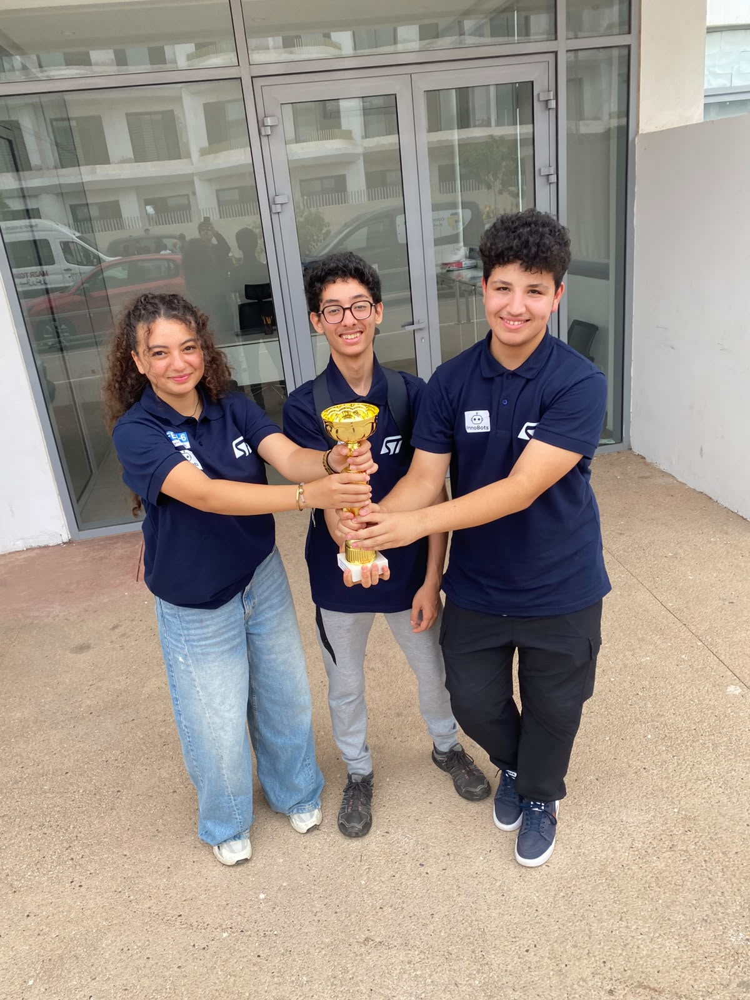
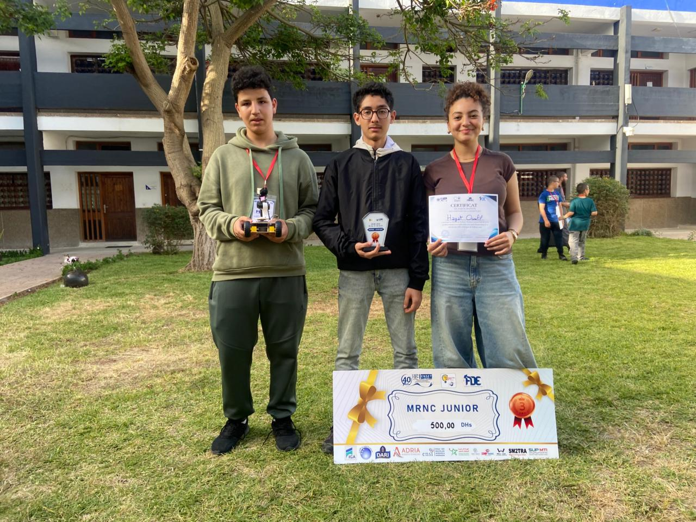
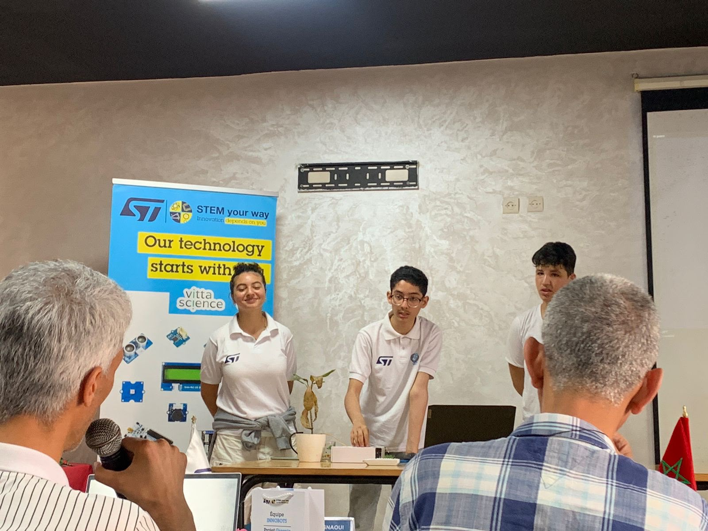

# InnoBots — WRO Future Engineers 2026

  

<strong>One team. One robot. A lot of ideas, tests, and engineering.</strong>

We're **InnoBots**, a team from **Ibn Mandour High School, Morocco**, competing in **WRO Future Engineers 2026**. This repository presents our robot, its mechanical and electrical design, the firmware, and our competition journey.

---

## Meet the robot

The following photographs show the robot from six sides.

<table>
  <tr>
    <td align="center"><strong>Front</strong> </td>
    <td align="center"><strong>Back</strong> </td>
  </tr>
  <tr>
    <td align="center"><strong>Left</strong> </td>
    <td align="center"><strong>Right</strong> </td>
  </tr>
  <tr>
    <td colspan="2" align="center"><strong>Top</strong> </td>
  </tr>
  <tr>
    <td colspan="2" align="center"><strong>Bottom — chassis underside</strong> </td>
  </tr>
</table>

## The team

- **Saad Hantar — Team Leader & Electronics:** team coordination, electronics, and hardware integration.
- **Ziad El Yafi — Graphics & Visual Design:** visual identity, graphic design, and project presentation.
- **Hayat Oumlil — Communications:** team communication, outreach, and presentation.

The robot is a shared effort, with all members contributing to engineering decisions and problem-solving.

## Our journey & achievements

The three team members studied together for three years at Ibn Mandour High School in the **Science and Electrical Sciences & Technologies** branch. After high school, we continued our studies at different schools while remaining together as a team.

- **WRO 2026 — Future Engineers: 1st Place.**
  

- **WRO 2025 — Future Innovators: 3rd Place.**
- **WRO Open Championship — Slovenia: Qualified.** The team qualified but was unable to attend.
- **MRNC 2026 — Winner.**
  

- **Nawabigh ST — Winner.**
  

Follow our updates on [Instagram — @innob.ots](https://www.instagram.com/innob.ots/).

---

## Repository structure

| Folder / file | Description |
|---|---|
| [Code/](Code/) | Arduino firmware modules for motor control, steering, and serial communication |
| [Mech/](Mech/) | SolidWorks part models and mechanical design renders |
| [Elec/](Elec/) | Electrical architecture and power-management documentation |
| [docs/](docs/) | Parts inventory and motor-selection / torque-analysis references |
| [v-photos/](v-photos/) | Robot photographs from different angles |
| [t-photos/](t-photos/) | Team and competition photographs |

## 1. Mechanical design

The robot's mechanical structure is designed around a compact chassis, mounted components, and wheel assemblies. The SolidWorks models in [Mech/](Mech/) represent the main structural and drivetrain-related parts. The design uses mounting holes, raised standoffs, slots, and shaped covers to organize the components and provide attachment points.

### CAD components

| SolidWorks part | Design role |
|---|---|
| [chassis.SLDPRT](Mech/chassis.SLDPRT) | Main structural chassis plate. Its perimeter and mounting holes provide the base for the robot's components. |
| [chassis_top.SLDPRT](Mech/chassis_top.SLDPRT) | Upper chassis plate / mounting layer. The model includes raised mounting bosses and elongated slots for component attachment. |
| [backward.SLDPRT](Mech/backward.SLDPRT) | Rear structural or mounting component, shaped to fit the rear section of the chassis. |
| [left-cover.SLDPRT](Mech/left-cover.SLDPRT) | Side cover or protective panel with openings for mechanical access or mounting. |
| [rim.SLDPRT](Mech/rim.SLDPRT) | Wheel rim model, with a central hub and openings distributed around the wheel face. |
| [encoder.SLDPRT](Mech/encoder.SLDPRT) | Encoder-related mechanical part used in the drivetrain / motor-feedback assembly. |

### Mechanical CAD views

The following renders show the geometry of the individual parts. They are visual CAD views rather than dimensioned manufacturing drawings.

  
   <em>Main chassis plate with perimeter mounting holes and rear mounting features.</em>

  
   <em>Upper chassis plate showing raised mounting bosses and elongated slots.</em>

  
   <em>Side structural component with mounting openings.</em>

  
   <em>Wheel rim with central hub and circumferential openings.</em>

  
   <em>Curved cover / structural panel with rectangular openings.</em>

The original SolidWorks part files are retained in the [Mech folder](Mech/) so the geometry can be opened and inspected in compatible CAD software.

### Dimensions and mobility

The documented compact envelope is approximately **115 mm × 196 mm**. The compact footprint supports maneuverability in the competition course while keeping the mechanical layout organized.

### Drive motor selection

The selected drive motor is the **RE-260RA-2670 DC motor** with a stated **17:1 reduction ratio**. The team's motor-selection reference lists a 3.0 V operating point. At the listed maximum-efficiency point (10,200 rpm and 1.5 mN·m), an 80% gearbox-efficiency assumption gives an estimated output speed of 600 rpm and output torque of 20.4 mN·m. With 44 mm diameter wheels, the corresponding theoretical linear speed is approximately 1.38 m/s.

The component inventory and the team's torque calculation are documented in [docs/parts-list.md](docs/parts-list.md).

## 2. Electronics, power & sensors

The electronics connect the controller, motor driver, sensors, and battery. The project hardware inventory includes:

- **Raspberry Pi 5** — main computing platform.
- **Raspberry Pi Camera Module 3** — visual sensing.
- **D500 LiDAR** — distance sensing.
- **Arduino Pro Mini** — low-level control.
- **Encoder** — motor-speed feedback.
- **DRV8833** — DC motor driver.
- **MG90S servo** — steering actuator.
- **2S battery pack, 2S BMS, and XL4015 converter** — power source, battery protection, and voltage regulation.

### Firmware pin assignments

The following assignments are defined in the current source files:

| Function | Pin | Source |
|---|---:|---|
| Motor encoder | D3 | `motor.cpp` |
| Motor driver enable / PWM | D5 | `motor.cpp` |
| Motor direction input 1 | D7 | `motor.cpp` |
| Motor direction input 2 | D4 | `motor.cpp` |
| Steering servo signal | D5 | `sterring.cpp` |

The source currently assigns D5 to both motor PWM/enable and the steering servo signal. This is a pin assignment conflict in the present code and is important context when interpreting the firmware configuration.

### Power architecture

The power-management document describes a 2S battery-based architecture with battery protection, a main switch and fuse, a regulated supply for low-voltage electronics, and a motor-driver supply. The power budget is an estimate based on the project values, not a laboratory measurement.

See [Elec/POWER_MANAGEMENT.md](Elec/POWER_MANAGEMENT.md) for the block diagram and load estimate.

## 3. Software architecture

The firmware is written in Arduino C++ and divided into modules.

### Main program — `main.ino`

The current main program initializes the motor and serial modules, sets the motor direction, reports measured motor speed over serial, sets a speed target, and repeatedly calls the motor update function. It serves as a motor-control test program.

### Motor control — `motor.cpp`

The motor module uses an encoder interrupt to record pulse timing. The `currentRpm()` function estimates rotational speed from the pulse period. The `motorRun()` function updates the PWM command at approximately 50 ms intervals using a proportional / derivative control structure, limits the command to the 0–255 range, and sends it to the motor driver. The control gains are configurable through `setKp()` and `setKd()`.

The RPM calculation depends on the encoder pulse count and drivetrain configuration. The code's scaling factor should be interpreted together with the encoder specification.

### Steering — `sterring.cpp`

The steering module attaches the servo and provides an interface for requesting a steering angle.

### UART communication — `uart.cpp`

The UART module initializes serial communication at **115200 baud**. It supports sending text lines and reading incoming text until a newline character.

## 4. Engineering references

This section brings together the official description of the WRO Future Engineers 2026 challenges and documentation for programming concepts that appear in the robot's Arduino code. These links are provided to help readers understand the challenge and the technologies used in the project.

### WRO Future Engineers 2026 challenge

The 2026 category has two autonomous-driving challenges. Each attempt is a time-attack run: one vehicle drives on the field at a time, and the objective is to complete the required course autonomously within the round time.

- **Open Challenge:** The vehicle must complete three laps. The positions of the inner track walls are randomized, changing the track layout between rounds. The starting position and driving direction can also change. There are no traffic-sign pillars in this challenge, and the vehicle must finish by stopping autonomously in the designated finish section.
- **Obstacle Challenge:** The vehicle must complete three laps while responding to randomly positioned traffic-sign pillars. A red pillar indicates that the vehicle must follow the right side of the lane; a green pillar indicates that it must follow the left side. The vehicle must avoid moving the pillars. After completing the laps, it must locate the parking area and perform a parallel-parking manoeuvre.

Official documents:
- [WRO Future Engineers 2026 — Official Game Rules (PDF)](https://wro-association.org/wp-content/uploads/2026/01/WRO-2026-Future-Engineers-Self-Driving-Cars-General-Rules-FINAL.pdf)
- [WRO 2026 Season](https://wro-association.org/competition/2026-season/)

### Programming concepts visible in our code

The current Arduino source files contain examples of the following control and communication concepts:

| Project code | Concept | Reference |
|---|---|---|
| `Code/motor.cpp` | Encoder pulse measurement using an external interrupt | [Arduino `attachInterrupt()`](https://docs.arduino.cc/language-reference/en/functions/external-interrupts/attachInterrupt) |
| `Code/motor.cpp` | PWM output to control the motor-driver speed command | [Arduino `analogWrite()`](https://docs.arduino.cc/language-reference/en/functions/analog-io/analogWrite) |
| `Code/sterring.cpp` | Servo attachment and angle commands | [Arduino Servo library](https://github.com/arduino-libraries/Servo) |
| `Code/uart.cpp` | Serial communication and newline-terminated messages | [Arduino Serial / Stream reference](https://docs.arduino.cc/language-reference/en/functions/communication/serial/) |

In the current repository, these files show the low-level building blocks for motor feedback and control, steering commands, and serial communication. The main Arduino sketch is a motor test program. The repository does not currently show a complete camera/LiDAR perception pipeline or a complete autonomous navigation program for the two challenge rounds, so this section does not claim that those functions are implemented.

### Hardware documentation

The component list and the team's motor-selection and torque calculations are included in [docs/parts-list.md](docs/parts-list.md). The power distribution concept is described in [Elec/POWER_MANAGEMENT.md](Elec/POWER_MANAGEMENT.md). These are project design notes and calculations; the competition rules and Arduino links above are external references for the challenge requirements and programming concepts.
## 5. Building and project files

- Mechanical part models are stored in [Mech/](Mech/).
- Electrical architecture is documented in [Elec/](Elec/).
- Firmware source files are stored in [Code/](Code/).
- Component information and motor calculations are in [docs/parts-list.md](docs/parts-list.md).

The `.SLDPRT` files are native SolidWorks part documents. The repository also includes rendered CAD views to make the geometry easier to review without opening the CAD files.

---

  <strong>Built by InnoBots · Ibn Mandour High School · Morocco</strong> 
  <em>Think together. Build together. Test. Improve. Repeat.</em>

